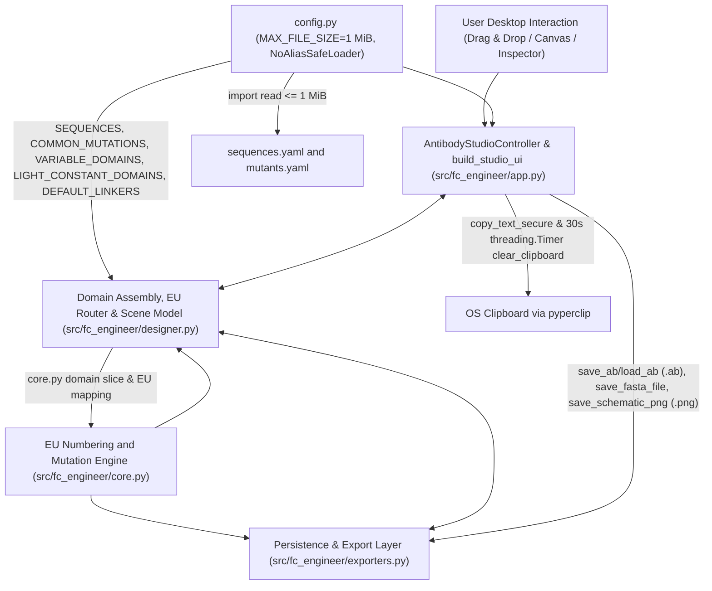

# Fc Engineering Studio

인간 IgG 및 이중특이성 항체(Monospecific IgG, CrossMab, IgG-scFv, scFv-Fc, DVD-Ig, BiTE 등)의 **도메인 토폴로지**와 **EU Numbering** 기반 Fc 변이 서열을 설계·분석하는 Flet 기반 로컬 데스크톱 애플리케이션입니다.

## Architecture & Subdirectory Index



### Subdirectory Contracts

| Path | Classification | Description | Contract |
| :--- | :--- | :--- | :--- |
| `src/` | Hay (Intermediate Blueprint) | Source package container (`src-layout`) | [src/README.md](./src/README.md) |
| `src/fc_engineer/` | Peanut (Component Package) | Core EU numbering, modular domain/chain engine, YAML loader, `.ab`/FASTA/GenBank/CSV/PNG exporters, and Flet desktop GUI | [src/fc_engineer/README.md](./src/fc_engineer/README.md) |

* **Design Specification:** [docs/designs/flet-antibody-studio.md](./docs/designs/flet-antibody-studio.md)

## Interface

* **CLI Script & Module Entry Points:**
  * `[pyproject.toml:fc-engineer]` -> `[src/fc_engineer/app.py:main]` (`ft.run(...)`)
  * `[src/fc_engineer/__main__.py]` (`if __name__ == "__main__": main()`)
  * `[src/fc_engineer/__init__.py:__version__]` (`"0.0.1"`)
* **Flet Desktop GUI & Controller (`[src/fc_engineer/app.py]`):**
  * `[src/fc_engineer/app.py:AntibodyStudioController]`, `[src/fc_engineer/app.py:build_studio_ui]`, `[src/fc_engineer/app.py:main]`
* **Domain Assembly & Scene Model (`[src/fc_engineer/designer.py]`):**
  * Dataclasses: `DomainBlock`, `PolypeptideChain`, `InterChainPairing`, `AntibodyProject`, `SchematicNode`, `SchematicEdge`, `SchematicPairingEdge`, `SchematicScene`
  * Key functions: `build_format_template`, `build_preset_map`, `resolve_domain_base_sequence`, `resolve_domain_sequence`, `assemble_chain_sequence`, `route_mutations_to_chain`, `remove_preset_from_chain`, `remove_domain_from_chain`, `remove_chain_from_project`, `diff_chain_sequences`, `analyze_chain_developability`, `add_file_custom_mutation`, `reflow_chain_coordinates`, `build_schematic_scene`
* **Core Sequence & EU Numbering API (`[src/fc_engineer/core.py]`):**
  * Constants: `EU_START` (`118`), `IGG3_HINGE_EXTRA` (`47`), `IGG3_GAP_END` (`230`), `CONSTANT_DOMAIN_EU_RANGES`, `MAX_MUTATION_STRING_LENGTH` (`1000`), `MAX_MUTATIONS` (`50`), `MAX_BATCH_ITEMS` (`20`), `MAX_BATCH_LENGTH` (`2000`)
  * Functions: `get_residue_index`, `get_eu_position`, `get_domain_slice_bounds`, `slice_constant_domain`, `get_domain_residue_index`, `get_domain_eu_position`, `diff_sequences`, `parse_mutation`, `parse_mutation_list`, `apply_mutations`, `apply_domain_mutations`, `generate_batch`, `analyze_developability`
* **Configuration & Export Formatters (`[src/fc_engineer/config.py]`, `[src/fc_engineer/exporters.py]`):**
  * Config: `MAX_FILE_SIZE` (`1 MiB`), `NoAliasSafeLoader`, `load_yaml_data`, `load_domain_templates`, `log_sanitized_error`, `SEQUENCES`, `COMMON_MUTATIONS`, `VARIABLE_DOMAINS`, `LIGHT_CONSTANT_DOMAINS`, `DEFAULT_LINKERS`, `logger`
  * Exporters: `MAX_EXPORT_SEQUENCE_LENGTH` (`10000`), `MAX_METADATA_LENGTH` (`200`), `MAX_PNG_DIMENSION` (`8192`), `sanitize_locus`, `format_genbank`, `format_csv_report`, `format_project_fasta`, `save_fasta_file`, `serialize_ab_project`, `parse_ab_project`, `save_ab_file`, `load_ab_file`, `export_schematic_png`, `save_schematic_png`

## Invariants

* **Safe YAML Loading (`[src/fc_engineer/config.py:NoAliasSafeLoader.compose_node]`, `[src/fc_engineer/config.py:load_yaml_data]`):** Rejects non-regular files via `os.path.isfile`, enforces `MAX_FILE_SIZE = 1 MiB` (`os.path.getsize` and bounded `f.read(MAX_FILE_SIZE + 1)`), blocks YAML `AliasEvent` bombs, caps nesting at `MAX_DEPTH = 50`, and validates exact schemas across `SEQUENCES`, `VARIABLE_DOMAINS`, `LIGHT_CONSTANT_DOMAINS`, `DEFAULT_LINKERS`, and `COMMON_MUTATIONS`.
* **EU Alignment Across IgG1–IgG4 & Isolated Constant Domains (`[src/fc_engineer/core.py:get_residue_index]`, `[src/fc_engineer/core.py:get_eu_position]`, `[src/fc_engineer/core.py:get_domain_slice_bounds]`, `[src/fc_engineer/core.py:get_domain_eu_position]`):** Starts at `EU_START = 118`; maps IgG2/IgG4 hinge deletions `223..225` and IgG3 unmapped repeat hinge positions `223..230` (`IGG3_GAP_END`) to `None`; `get_eu_position` returns `None` for negative indices and IgG3 extended-hinge repeat indices `105..159`, while domain helpers map per-domain slices (`CH1`, `Hinge`, `CH2`, `CH3`) without N-terminal variable/linker shifts.
* **Strict ASCII Validation, Atomic Routing & Persistence Bounds (`[src/fc_engineer/core.py:parse_mutation]`, `[src/fc_engineer/designer.py:route_mutations_to_chain]`, `[src/fc_engineer/exporters.py:parse_ab_project]`):** Enforces ASCII-only `[0-9]` regexes with `\Z` anchors (`len <= 10`), `[A-Z]+` base sequences, Phase 1 dry-run rollback before mutating any domain/chain, `.ab` 1 MiB file size limits, collection caps (`1..16` chains, `1..32` domains/chain, `<= 64` pairings, `<= 100` file custom mutations, `<= 50` `mutation_history` entries of `<= 200` chars), exact `ORIGIN == assembled_seq` parity, and `os.path.basename` path redaction on file I/O errors.
* **Clipboard Auto-Clear Security (`[src/fc_engineer/app.py:AntibodyStudioController.copy_text_secure]`, `[src/fc_engineer/app.py:AntibodyStudioController.clear_clipboard]`, `[src/fc_engineer/app.py:AntibodyStudioController.shutdown]`):** Protects `copied_fasta`, `_clipboard_timer`, and monotonic `_clipboard_gen` under `threading.RLock`, wipes prior matching clipboard state before copying new payloads, schedules a daemon 30-second `threading.Timer`, clears only matching content with current generation token, and purges clipboard state on `.ab` load, format switch, window close, and `atexit`.

## Side Effects

* **Import-Time Config Reads (`[src/fc_engineer/config.py:_load_all_config]`):** Reads `./src/fc_engineer/data/sequences.yaml` and `./src/fc_engineer/data/mutants.yaml` once on import, logging sanitized diagnostics to `logger.error` and `sys.stderr`.
* **Local File I/O (`[src/fc_engineer/exporters.py]`):** Reads `.ab` files (`load_ab_file`) and writes `.ab`, `.fasta`/`.fa`, and transparent RGBA `.png` schematics via Pillow (`Image`).
* **OS Clipboard & Timers (`[src/fc_engineer/app.py:AntibodyStudioController]`):** Copies exported FASTA strings via `pyperclip.copy`, manages `threading.Timer(30.0, ...)` callbacks, and clears matching OS clipboard data on expiry or teardown.
* **Flet Desktop Loop & System Date (`[src/fc_engineer/app.py:main]`, `[src/fc_engineer/exporters.py:serialize_ab_project]`):** Launches `ft.run(...)` with native file picker dialogs and reads `date.today()` for GenBank headers.

## Verification

```bash
uv run pytest
```

---

## 주요 기능

- **7종 항체 및 이중항체 포맷 템플릿**: `Monospecific IgG`, `CrossMab`, `IgG-scFv`, `scFv-Fc`, `DVD-Ig`, `BiTE`, `Custom Construct`
- **모듈형 드래그 앤 드롭 체인/도메인 조립**: `VH`, `VL`, `CH1`, `CL` (`κ`/`λ`), `Hinge`, `CH2`, `CH3`, `G4S` 블록을 2D 캔버스 및 N→C 체인 스트립에서 자유롭게 배치·이동·페어링
- **유연한 Variable / Linker 편집**: 사용자 정의 `VH`, `VL`, `G4S` 서열 입력(미입력 시 내장 Target Arm A/B 및 `(GGGGS)3` 기본값 자동 사용)
- **도메인 인식 EU Numbering & 교차 도메인 변이 라우팅**: `LALA`, `YTE`, `LS`, `GAALIELS`, `Knob`/`Hole` 등 프리셋 및 EU 변이 입력 시 `Hinge`/`CH2`/`CH3`에 원자적으로 적용 (부분 실패 시 롤백)
- **단일 `.ab` 파일 저장/불러오기**: 체인 서열, 도메인 토폴로지, 2D 캔버스 좌표, 변이 적용 이력, **현재 파일 전용 커스텀 변이(`file_custom_mutations`)**를 GenBank 스타일 `.ab` 텍스트 파일에 통합 저장
- **FASTA / 투명 배경 PNG 모식도 내보내기**: 체인별 multi-FASTA 및 Pillow 기반 투명 RGBA `.png` 모식도 파일 출력
- **Developability PTM 취약 부위 점검**: `N-X-S/T` 글리코실화, `NG` 탈아미드화, `DG` 이성질화, `M252/M428` 산화 부위 탐지

## 설치 및 실행

* **요구 사양:** Python `>= 3.14` ([pyproject.toml](./pyproject.toml)), [uv](https://github.com/astral-sh/uv)

```bash
# 의존성 설치 (flet[desktop], pillow, pyyaml, pyperclip)
uv sync

# Flet 데스크톱 애플리케이션 실행
uv run fc-engineer

# 또는 모듈로 직접 실행
uv run python -m fc_engineer

# 테스트 실행
uv run pytest
```

## 주요 조작 및 내보내기

1. **상단 툴바**: 프로젝트 이름 편집, 포맷 템플릿 전환(`IgG` / `CrossMab` / `IgG-scFv` / `scFv-Fc` / `DVD-Ig` / `BiTE` / `Custom`), `Add Chain`, `Load .ab`, `Save .ab`, `Export FASTA`, `Export PNG`, `Copy FASTA (30s Auto-Clear)`.
2. **좌측 도메인 팔레트 & 페어링 빌더**: 8종 도메인 블록을 중앙 체인 스트립 슬롯으로 드래그하여 추가하고, 체인 간/체인 내 `VH_VL`, `CH1_CL`, `HINGE_DISULFIDE`, `CH3_DIMER` 페어링을 구성합니다.
3. **중앙 2D 캔버스 & 체인 스트립**: 캔버스에서 도메인을 마우스로 드래그해 2D 위치를 고정(`pinned=True`)하거나, 체인 스트립에서 도메인 순서를 변경 및 다른 체인으로 이동할 수 있습니다.
4. **우측 인스펙터**: 선택한 도메인의 Isotype(`igg1`–`igg4`)/Allotype(`WT`, `trastzumab`, `rituximab`, `cetuximab`, `g1m17`, `g1m3`, `g1m1`), `CL` 서브타입, `VH`/`VL`/`G4S` 서열, Fc 프리셋(선택적 `Apply to all heavy chains`), 파일 전용 커스텀 변이 등록, 실시간 서열 diff 및 PTM 점검 결과를 확인합니다.

## 프로젝트 구조

```
src/
├── README.md                # Intermediate Blueprint (Hay) 계약
└── fc_engineer/
    ├── README.md            # Component Package (Peanut) 계약
    ├── __init__.py          # 패키지 메타데이터
    ├── __main__.py          # python -m fc_engineer 진입점
    ├── app.py               # AntibodyStudioController 및 Flet 데스크톱 UI
    ├── designer.py          # 도메인/체인 모델, 포맷 템플릿, 교차 도메인 라우팅, 2D 씬 빌더
    ├── core.py              # EU Numbering 계산, 도메인 슬라이싱, 변이·diff·developability 로직
    ├── config.py            # YAML 데이터 로딩 및 보안 검증 (NoAliasSafeLoader, 1 MiB 제한)
    ├── exporters.py         # .ab 프로젝트 저장/파싱, multi-FASTA, GenBank, CSV, 투명 PNG 렌더러
    └── data/
        ├── sequences.yaml   # IgG1-4 상수 영역 및 기본 VH/VL/CL/G4S 서열
        └── mutants.yaml     # 읽기 전용 기본 Fc 변이 프리셋 데이터
tests/                       # 단위 및 헤드리스 UI 테스트
pyproject.toml               # 프로젝트 설정 및 의존성 정의
```

## 데이터 커스터마이징

* 패키지 기본 서열 및 읽기 전용 프리셋은 [sequences.yaml](./src/fc_engineer/data/sequences.yaml) 및 [mutants.yaml](./src/fc_engineer/data/mutants.yaml)에서 로드됩니다.
* 작업 중 사용자가 추가한 커스텀 변이는 패키지 `mutants.yaml`을 변경하지 않고 현재 작업 중인 `.ab` 파일의 `file_custom_mutations`에만 저장됩니다.
