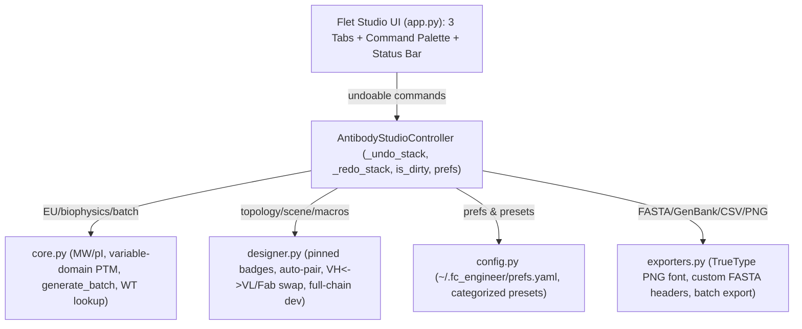

# Fc Engineering Studio — 100-Item UX Improvement Suite

* **Author:** fkt
* **Date:** 2026-11-16
* **Source Brief:** [ux-100-improvements.md](./ux-100-improvements.md)

## Overview
Fc Engineering Studio provides EU-numbered antibody domain assembly, bispecific/multispecific templates, 2D schematic rendering, and `.ab`/FASTA/GenBank/CSV/PNG exports. However, the current desktop application still has structural friction across all 10 UX areas: missing Undo/Redo and dirty-state protection, no keyboard shortcuts or command palette, partial Light/Dark repainting, flat text sequence/developability output, unexposed batch generation (`core.generate_batch`), missing canvas zoom/snap/grid/pin-badge ergonomics, and limited onboarding/error-recovery guidance.

This design specifies the architecture and complete implementation plan to deliver the remaining **95 UX improvements** (building on the 5 items already completed: #1 Unpin/Reset Layout, #3 negative-coord clamping, #51 GenBank/CSV export, #52 PNG scale selector, and #61 Style spacing sliders) across `src/fc_engineer/app.py`, `src/fc_engineer/designer.py`, `src/fc_engineer/core.py`, `src/fc_engineer/config.py`, and `src/fc_engineer/exporters.py`.

## The Problem
1. **Data Loss & Missing Recovery:** Destructive actions (`Remove Chain`, `Delete Domain`, `select_format`, `window CLOSE`) execute without dirty-state guards, confirmation dialogs, or an `_undo_stack` / `_redo_stack`.
2. **High-Friction Authoring Loops:** Adding/reordering domains, disambiguating multi-VH pairing endpoints (`DVD-Ig`, `2+1`), removing individual custom mutations, and finding EU positions require repeated tab switching or guesswork.
3. **Opaque Sequence & Developability Output:** `EU Diffs`, `Developability`, and `Assembled Chain Sequence` render as unformatted plain text, variable/linker domains skip PTM scanning, and `mw`/`pI` are absent.
4. **Canvas & Desktop Ergonomics Gaps:** The 2D canvas lacks zoom/fit-to-view, snap-to-grid, chain-level dragging, clickable pairing handles, tooltips, drag-end throttling, window state persistence, and keyboard shortcuts (`Cmd/Ctrl+S/O/Z/K`).

## Goals
* Deliver all 95 remaining UX improvements from [ux-100-improvements.md](./ux-100-improvements.md) across all 10 functional areas without breaking existing `.ab` `schema_version: 1` or `.yaml` theme compatibility.
* Add bounded Undo/Redo (`50` snapshots), `is_dirty` tracking, close/format-switch confirmations, debounced crash-recovery `.ab` snapshots, and persistent user preferences (`~/.fc_engineer/prefs.yaml`).
* Upgrade the 2D canvas with zoom/fit-to-view, snap-to-grid, alignment guides, pin badges, chain-header dragging, clickable pairing/disulfide handles, context-aware double-click, hover tooltips, empty-chain placeholders, and drag-end throttling.
* Upgrade Fc mutation, sequence, and developability UX with categorized presets, WT autocomplete, conflict previews, removable custom-mutation chips, `mutation_history` audit viewer, variable-domain PTM scanning, domain-colored sequence spans, MW/pI metrics, and batch variant generation (`core.generate_batch()`).
* Upgrade desktop productivity with global keyboard shortcuts, `Cmd/Ctrl+K` command palette, status bar with clipboard countdown, recent projects, `"Save"` vs. `"Save As"`, TrueType PNG font scaling, and `"Open Folder"` export feedback.

## Non-Goals
* Breaking `.ab` `schema_version: 1` manifest backward compatibility.
* Adding network/cloud sync, external database queries, or paid code-signing steps.
* Replacing Flet's desktop rendering engine.

---

## Technical Plan

### Architecture & Key Subsystems
1. **Controller State, Undo/Redo & Persistence (`app.py`, `config.py`):**
   * Add `_undo_stack: List[AntibodyProject]` / `_redo_stack: List[AntibodyProject]` (capped at `50`), `is_dirty: bool`, `current_file_path: Optional[str]`, `wiz_state`, and `prefs` (`~/.fc_engineer/prefs.yaml` storing `recent_files`, `theme_mode`, `active_theme`, `window_size`, `side_panel_width`, `side_panel_tab`, `png_scale`).
   * Write debounced crash-recovery `.ab` snapshots to `<tempdir>/fc_engineer_recovery.ab` and prompt recovery on startup if present.
   * Guard `select_format()`, `load_ab()`, and `on_window_event(CLOSE)` when `is_dirty` is True.
2. **Core Biophysics & Variable-Domain Analysis (`core.py`, `designer.py`):**
   * Add `compute_protein_metrics(sequence: str) -> Tuple[float, float]` returning `(mw_kda, theoretical_pi)` using standard monoisotopic/average residue weights and Henderson-Hasselbalch pKa iteration.
   * Extend `analyze_chain_developability(..., include_variable: bool = False)` to optionally scan `VH`/`VL`/`CL`/`G4S` domains with 1-based local residue positions.
   * Add `lookup_wt_residue(eu_pos: int, isotype: str) -> Optional[str]` for inline WT autocomplete in `open_fc_mutations_modal`.
   * Extend `swap_crossmab_ch1_cl` with `mode` (`"ch1_cl"`, `"vh_vl"`, `"fab"`), add `auto_detect_standard_pairings()`, `insert_macro_block()` (`"scfv"`, `"fc"`), `rename_chain()`, `reorder_chain()`, `remove_custom_mutation()`, `delete_file_custom_mutation()`, and `reset_chain_mutations()`.
   * Register `ChargePair_A` (`K392D/K409D`) and `ChargePair_B` (`D356K/D399K`) in `mutants.yaml` + categorized preset metadata.
3. **2D Canvas & Exporter Upgrades (`app.py`, `exporters.py`):**
   * Add `zoom_scale: float = 1.0`, `snap_to_grid: bool = False`, `show_alignment_guides: bool = True`, `pinned: bool` indicator on `SchematicNode`, empty-chain dashed placeholder, clickable pairing/disulfide midpoints, chain-header drag translation, hover tooltips, and drag-end throttling (`on_pan_end`).
   * Upgrade `export_schematic_png()` to load a scalable TrueType font (system sans-serif fallback to `ImageFont.load_default()`), optional solid background color, and contrast warnings.
   * Add `header_style` option to `format_project_fasta()` and batch multi-FASTA/CSV export via `core.generate_batch()`.
4. **Productivity, Shortcuts & Visual Polish (`app.py`):**
   * Add compact Studio quick-action strip (Save, Export PNG, Copy FASTA, Undo/Redo, Vertical/Horizontal toggle, Zoom, Reset Layout), `Cmd/Ctrl+S/O/Z/Shift+Z/K`, arrow-key domain navigation, `Cmd/Ctrl+K` Command Palette, persistent bottom status bar with 30s clipboard countdown (`page.run_task` safe), resizable `studio_side_panel`, collapsible `Chain` vs `Selected Domain` sections, color-coded sequence spans & developability chips, `?` Help Cheat-Sheet, and `"Open Folder"` SnackBar action.

---

## Alternatives Considered

1. **Snapshot Undo/Redo (`copy.deepcopy(project)`) vs. Per-Action Inverse Command Pattern:**
   * **Chosen:** Bounded `50`-entry `copy.deepcopy(AntibodyProject)` snapshots. Each `AntibodyProject` is small (<50 KB), so snapshots guarantee exact rollback across complex atomic operations (`apply_heterodimer_pair`, `swap_crossmab_ch1_cl`, `move_domain_across_chains`).
   * *Rejected by author: Per-action inverse commands require writing and maintaining 15+ paired undo/redo handlers and risk state drift.*
2. **User Preferences Storage (`~/.fc_engineer/prefs.yaml`) vs. Embedding in `.ab` Files:**
   * **Chosen:** Local YAML preferences file validated with `NoAliasSafeLoader` and `MAX_FILE_SIZE`. Keeps `.ab` `schema_version: 1` strictly project-only.
   * *Rejected by author: Storing window geometry or recent paths inside `.ab` files leaks local filesystem paths into shared project files.*
3. **TrueType PNG Font Resolution (System Font Lookup + `load_default` Fallback) vs. Bundling `.ttf` Files:**
   * **Chosen:** Probe standard OS sans-serif `.ttf` paths (`DejaVuSans.ttf`, `Arial.ttf`, `Helvetica.ttc`) with `ImageFont.truetype(..., size=int(11 * scale))` and fall back to `ImageFont.load_default()`, avoiding binary bloat in `flet pack` archives.
   * *Rejected by author: Bundling multi-megabyte font files increases standalone installer size.*

---

## Detailed Implementation

| File | Scope & Rationale | UX Items Covered |
| :--- | :--- | :--- |
| [src/fc_engineer/core.py](file:///Users/fkt/Downloads/PROJECT/Fc-engineering-studio/src/fc_engineer/core.py) | Add `compute_protein_metrics()` (MW kDa & theoretical pI) and `lookup_wt_residue(eu_pos, isotype)` for EU WT autocomplete. | #26, #38 |
| [src/fc_engineer/data/mutants.yaml](file:///Users/fkt/Downloads/PROJECT/Fc-engineering-studio/src/fc_engineer/data/mutants.yaml) | Add `ChargePair_A` / `ChargePair_B` and optional `category` tags for categorized Fc modal grouping. | #21, #49 |
| [src/fc_engineer/config.py](file:///Users/fkt/Downloads/PROJECT/Fc-engineering-studio/src/fc_engineer/config.py) | Add `load_user_prefs()` / `save_user_prefs()` (`~/.fc_engineer/prefs.yaml`) with `NoAliasSafeLoader` and `MAX_FILE_SIZE` for recent projects, window geometry, and active theme/mode. | #56, #94, #95 |
| [src/fc_engineer/designer.py](file:///Users/fkt/Downloads/PROJECT/Fc-engineering-studio/src/fc_engineer/designer.py) | Add `pinned: bool = False` on `SchematicNode`, `include_variable` on `analyze_chain_developability()`, `rename_chain()`, `reorder_chain()`, `insert_macro_block()` (`scfv`/`fc`), `swap_crossmab()` (`ch1_cl`/`vh_vl`/`fab`), `auto_detect_standard_pairings()`, `remove_custom_mutation()`, `delete_file_custom_mutation()`, and `reset_chain_mutations()`. | #2, #11, #12, #20, #23, #27, #30, #32, #47, #48 |
| [src/fc_engineer/exporters.py](file:///Users/fkt/Downloads/PROJECT/Fc-engineering-studio/src/fc_engineer/exporters.py) | Add `header_style` to `format_project_fasta()`, scalable TrueType font + optional solid background to `export_schematic_png()`, and `export_batch_variants()` wrapping `core.generate_batch()`. | #52, #53, #59, #60 |
| [src/fc_engineer/app.py](file:///Users/fkt/Downloads/PROJECT/Fc-engineering-studio/src/fc_engineer/app.py) | Implement `_undo_stack`/`_redo_stack`, `is_dirty`, `current_file_path`, crash-recovery snapshot, global shortcuts (`Cmd/Ctrl+S/O/Z/K`), Command Palette, Studio quick-action strip, canvas zoom/snap/grid/chain-drag/pairing-click/tooltips/throttled drag, empty-chain placeholder, categorized Fc modal with WT autocomplete & conflict preview, color-coded sequence spans & developability chips, resizable side panel + `Multispecific` sub-tab + `Pick on Canvas`, Style swatch pickers & auto-contrast, status bar with `page.run_task` clipboard countdown, confirmations, Help dialog, and `"Open Folder"` SnackBar action. | #2, #4–#10, #13–#19, #21–#25, #28–#31, #33–#37, #39–#46, #50, #54–#58, #62–#100 |
| [tests/test_logic.py](file:///Users/fkt/Downloads/PROJECT/Fc-engineering-studio/tests/test_logic.py) | Test `compute_protein_metrics()`, `lookup_wt_residue()`, `include_variable` developability, macro blocks, `VH<->VL`/`Fab` swaps, and `auto_detect_standard_pairings()`. | All core/designer invariants |
| [tests/test_exporters.py](file:///Users/fkt/Downloads/PROJECT/Fc-engineering-studio/tests/test_exporters.py) | Test custom FASTA headers, TrueType PNG rendering + solid background, and batch variant export. | All exporter invariants |
| [tests/test_ui.py](file:///Users/fkt/Downloads/PROJECT/Fc-engineering-studio/tests/test_ui.py) | Test Undo/Redo stacks, `is_dirty` close/format guards, prefs roundtrip, canvas zoom/pin/empty-placeholder, shortcuts/command palette, and UI controls. | All controller/UI invariants |

