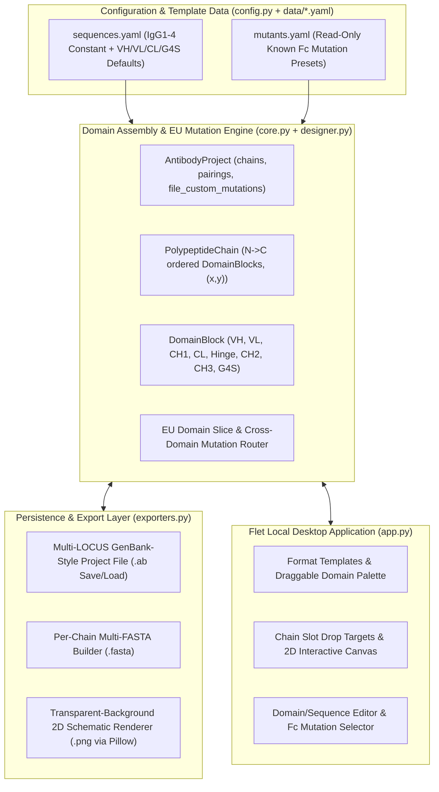

# Flet-Based Antibody and Bispecific Domain Engineering Studio

* **Author:** fkt
* **Date:** 2026-11-14

## The Problem

Fc Engineering Studio currently provides a terminal user interface (Textual) limited to applying EU-numbered point mutations to a single heavy-chain constant region string (`CH1-Hinge-CH2-CH3`, EU 118 to 447). While this works for symmetric Fc variants on a single heavy chain, antibody engineers designing monospecific and bispecific therapeutics (`CrossMab`, `IgG-scFv`, `scFv-Fc`, `DVD-Ig`, `BiTE`) face four operational bottlenecks:

1. **No Modular Domain or Multi-Chain Assembly:** Modern bispecific antibodies are composed of multiple polypeptide chains (up to four chains in `CrossMab`) assembled from modular building blocks (`VH`, `VL`, `CH1`, `CL`, `Hinge`, `CH2`, `CH3`, and `G4S` linkers). When domains are omitted (`scFv-Fc` lacks `CH1`), swapped (`CrossMab` exchanges `CH1` and `CL`), or fused (`IgG-scFv`, `DVD-Ig`, `BiTE`), a single static sequence string starting at EU 118 cannot represent the molecule or compute valid EU residue indices.
2. **Inability to Model Heterodimeric Fc Pairing:** Asymmetric bispecific formats require applying distinct Fc mutations to each heavy chain (such as `Knob` [`T366W`] on Heavy Chain A and `Hole` [`T366S/L368A/Y407V`] on Heavy Chain B) while sharing or varying effector-function mutations (`LALA`, `YTE`, `LS`). A single-sequence workflow forces users to generate chains one at a time and manually track which chains pair together.
3. **Lack of Visual Schematic Design and Export:** Terminal text widgets cannot support mouse drag-and-drop domain assembly, 2D spatial layout of multi-chain architectures, or export of transparent-background 2D schematic diagrams (`.png`) for presentations, lab notebooks, and sequence registration.
4. **No Persistent Project Format:** Currently, once a user closes the application, the selected architecture, applied mutation history, and custom mutations are lost. Users cannot save a single human-readable text file that captures the expressible per-chain sequences alongside the domain connection topology, 2D schematic coordinates, and file-scoped custom mutations.

## Overview

This design replaces the legacy Textual terminal interface with a local Flet desktop application built around a chain-and-domain engineering model (`src/fc_engineer/designer.py`) decoupled from the UI layer. Engineers assemble expressible polypeptide chains (`PolypeptideChain`) from domain blocks (`DomainBlock`), route preset and file-scoped EU mutations onto constant domains independently of chain position, and serialize or export workspaces via `.ab` GenBank-style project files, multi-FASTA sequences, and Pillow-rendered transparent `.png` schematics.

## Goals

* **Replace the Legacy TUI with a Flet Desktop GUI:** Remove the Textual TUI and provide a local desktop interface (`fc-engineer`) supporting mouse drag-and-drop domain assembly, 2D canvas positioning, and interactive domain/mutation inspection.
* **Expressible Polypeptide Chain Assembly and Pairing:** Allow users to assemble N-to-C polypeptide chains from `VH`, `VL`, `CH1`, `CL`, `Hinge`, `CH2`, `CH3`, and `G4S` linker blocks, define inter-chain pairings, and load starter templates for `Monospecific IgG`, `CrossMab`, `IgG-scFv`, `scFv-Fc`, `DVD-Ig`, and `BiTE`.
* **Editable Variable Regions and Linkers with Defaults:** Let users enter custom `VH` and `VL` sequences (falling back to built-in Target Arm A and Target Arm B example sequences when omitted) and customize linker sequences (defaulting to `G4S` repeats).
* **Domain-Aware EU Numbering and Per-File Custom Mutations:** Support selecting known Fc mutations from `mutants.yaml` on individual chains/domains (with automatic routing of cross-domain presets across `Hinge`, `CH2`, and `CH3` on the same chain) and adding custom EU mutations saved exclusively inside the current `.ab` project file.
* **Single-File `.ab` Project Persistence:** Save and load a human-readable, GenBank-style `.ab` text file that stores per-chain sequences, domain connection topology, inter-chain pairings, 2D schematic `(x, y)` coordinates, applied mutation history, and file-scoped custom mutations.
* **Sequence and Transparent Schematic Export:** Export expressible per-chain multi-FASTA sequences and transparent-background 2D schematic images (`.png`).

## Non-Goals

* **Retaining the Textual Terminal Interface:** Maintaining backward compatibility with the legacy Textual screens or dual TUI/GUI runtime modes is out of scope.
* **3D Structural Modeling:** Predicting or rendering 3D atomic coordinates (PDB/mmCIF, homology modeling, or AlphaFold integration) is out of scope; schematics are strictly 2D domain topology diagrams.
* **Global Persistence of User-Added Mutations:** Writing user-defined mutations back to `src/fc_engineer/data/mutants.yaml` or a global user profile is out of scope; custom mutations persist only in the `.ab` file where they were created.
* **Variable-Domain Numbering Systems (IMGT / Kabat / Chothia):** Automatic CDR numbering or point-mutation indexing inside `VH` and `VL` domains is out of scope; EU numbering applies specifically to constant domains (`CH1`, `Hinge`, `CH2`, `CH3`).
* **Cloud or Multi-User Server Deployment:** Running the application as a hosted web service or integrating with external database servers is out of scope.

## Technical Plan

### 1. System Architecture and Data Flow

The application separates biological sequence/topology rules from the Flet user interface so that domain assembly, EU residue indexing, `.ab` file persistence, and `.png` schematic rendering can be tested deterministically without launching a desktop window.

### 2. Core Data Model ([`src/fc_engineer/designer.py`](../../src/fc_engineer/designer.py))

* **`DomainBlock`**: Represents a single modular domain inside a polypeptide chain.
  * `id: str`: Unique identifier within the project matching `r"[A-Za-z0-9_]+\Z"` (maximum `64` characters, e.g., `hc1_ch2`).
  * `domain_type: str`: One of `"VH"`, `"VL"`, `"CH1"`, `"CL"`, `"Hinge"`, `"CH2"`, `"CH3"`, or `"G4S"`.
  * `isotype: str = "igg1"`: One of `"igg1"`, `"igg2"`, `"igg3"`, or `"igg4"` (used by `CH1`, `Hinge`, `CH2`, `CH3`).
  * `allotype: str = ""`: Allotype key in `SEQUENCES[isotype]` (empty string resolves to the first WT key for that isotype, e.g., `"WT(P01857-1)"`).
  * `template_key: str = ""`: Default template selector for non-Fc domains (empty string resolves by `domain_type` to `"VH_A"`, `"VL_A"`, `"CL_kappa"`, or `"G4S_3"`; allowed values `"VH_A"`, `"VH_B"`, `"VL_A"`, `"VL_B"`, `"CL_kappa"`, `"CL_lambda"`, `"G4S_3"`, `"G4S_2"`, `"G4S_1"`).
  * `custom_sequence: str = ""`: User-supplied sequence override for `"VH"`, `"VL"`, or `"G4S"` (empty string uses the fallback sequence from `template_key`).
  * `x: float = 0.0`, `y: float = 0.0`: Absolute 2D schematic canvas coordinates for this domain block, bounded to `[-10000.0, 10000.0]`.
  * `pinned: bool = False`: Defaults to `False`; set to `True` on manual 2D canvas drags so `reflow_chain_coordinates()` preserves manual coordinates.
  * `applied_presets: List[str] = field(default_factory=list)`: Preset labels currently active on this domain (e.g., `["LALA", "Knob"]`).
  * `custom_mutations: List[str] = field(default_factory=list)`: Ad-hoc user point mutations active on this domain (e.g., `["M428L", "N434S"]`), kept separate from `applied_presets`.
  * `mutation_history: List[str] = field(default_factory=list)`: Chronological audit list of mutation operations applied to this domain (e.g., `["Preset LALA: L234A/L235A", "Custom: T366W"]`).
* **`PolypeptideChain`**: Represents one expressible N-terminus-to-C-terminus polypeptide chain.
  * `id: str`, `name: str`: Chain identifier (`r"[A-Za-z0-9_]+\Z"`, maximum `64` characters) and human-readable label (e.g., `"HC_Knob"`, `"LC_A"`).
  * `domains: List[DomainBlock] = field(default_factory=list)`: Ordered N-to-C list of domains whose concatenated sequences form the expressed polypeptide.
  * `x: float = 0.0`, `y: float = 0.0`: Initial 2D layout anchor coordinates used to place newly added or reflowed domains on this chain (while each `DomainBlock` tracks its own absolute canvas position `(x, y)`).
* **`InterChainPairing`**: Represents a covalent disulfide bridge or non-covalent domain pairing between two distinct domains (`(chain_a_id, domain_a_id) != (chain_b_id, domain_b_id)`). Setting `chain_a_id == chain_b_id` is valid for intra-chain scFv `VH_VL` pairings (`IgG-scFv`, `scFv-Fc`, `BiTE`).
  * `id: str` (`r"[A-Za-z0-9_]+\Z"`, maximum `64` characters), `chain_a_id: str`, `domain_a_id: str`, `chain_b_id: str`, `domain_b_id: str`, `pairing_type: str` (`"VH_VL"`, `"CH1_CL"`, `"HINGE_DISULFIDE"`, `"CH3_DIMER"`).
* **`AntibodyProject`**: Root container for an engineering session.
  * `name: str`, `format_type: str = "custom"` (`"custom"`, `"igg"`, `"crossmab"`, `"igg_scfv"`, `"scfv_fc"`, `"dvd_ig"`, `"bite"`).
  * `chains: List[PolypeptideChain] = field(default_factory=list)`.
  * `pairings: List[InterChainPairing] = field(default_factory=list)`.
  * `file_custom_mutations: List[Dict[str, str]] = field(default_factory=list)`: User-added mutation definitions (`{"label": "...", "value": "..."}`) scoped to this project file.

### 3. Domain-Aware EU Numbering and Cross-Domain Mutation Routing ([`src/fc_engineer/core.py`](../../src/fc_engineer/core.py) & [`src/fc_engineer/designer.py`](../../src/fc_engineer/designer.py))

Existing functions in `src/fc_engineer/core.py` (`get_residue_index`, `get_eu_position`, `diff_sequences`, `parse_mutation`, `apply_mutations`, `generate_batch`, `analyze_developability`) remain intact for contiguous `CH1-Hinge-CH2-CH3` strings, while `diff_sequences()` and `analyze_developability()` accept an optional `domain_type: Optional[str] = None` parameter to reuse their diff and PTM-liability logic on isolated constant domains. Shared tokenization (`parse_mutation_list`) and constant-domain slicing keep `core.py` free of configuration dependencies:

| Domain Type | Canonical EU Range | Slice in `SEQUENCES[isotype][allotype]` |
| :--- | :--- | :--- |
| `CH1` | `118..215` | `full_seq[0 : get_residue_index(216, isotype)]` |
| `Hinge` | `216..230` | `full_seq[get_residue_index(216, isotype) : get_residue_index(231, isotype)]` |
| `CH2` | `231..340` | `full_seq[get_residue_index(231, isotype) : get_residue_index(341, isotype)]` |
| `CH3` | `341..447` | `full_seq[get_residue_index(341, isotype) : len(full_seq)]` |

1. **Forward and Reverse Per-Domain Index Calculation:**
   * Given an EU position `pos` and a constant domain `D` (`CH1`, `Hinge`, `CH2`, or `CH3`), `get_domain_slice_bounds(domain_type, isotype, full_seq_len)` computes `(start_idx, end_idx)` with `start_idx = get_residue_index(eu_start, isotype)` and `end_idx = min(raw_end, full_seq_len)` (catching C-terminally truncated allotypes such as `cetuximab` lacking `K447`). `get_domain_residue_index(pos, domain_type, isotype)` verifies that `pos` falls inside `D`'s canonical EU range, computes `global_idx = get_residue_index(pos, isotype)`, and subtracts `start_idx` to return the 0-based index inside `D`; `apply_domain_mutations()` validates `0 <= local_idx < len(domain_seq)` against the resolved domain WT sequence.
   * Conversely, `get_domain_eu_position(local_idx, domain_type, isotype)` validates `domain_type in CONSTANT_DOMAIN_EU_RANGES` and `local_idx >= 0`, checks `start_idx is not None` on `start_idx = get_residue_index(eu_start, isotype)`, and maps `start_idx + local_idx` via `get_eu_position()`, verifying the result stays within `D`'s canonical EU range (and returning `None` for non-EU extended-hinge repeat indices `105..159` in `igg3`).
2. **Atomic Cross-Domain Preset Routing and Reversible Toggling:** When a user applies a mutation preset from `mutants.yaml` or `file_custom_mutations` (such as `GAALIELS` = `G236A/A330L/I332E/M428L/N434S`) or ad-hoc point mutations to a polypeptide chain:
   * **Phase 1 (Atomic Validation):** `route_mutations_to_chain()` tokenizes `mutants_str` via `core.parse_mutation_list()`, groups tokens by owning constant domain (`CH1` 118–215, `Hinge` 216–230, `CH2` 231–340, `CH3` 341–447), and dry-runs `apply_domain_mutations()` against each touched domain's effective mutations (`get_effective_domain_mutations(domain, preset_map)`). If any token fails (for example, a missing target domain, `cetuximab` missing `K447`, `H435A` on `igg3` which carries `R435`, or an amino-acid conflict at the same EU residue), routing aborts cleanly without mutating any domain.
   * **Phase 2 (Atomic Commit & Disjoint State):** Identical tokens shared across overlapping presets (`LALA` + `PGLALA`) are deduplicated when expanding effective mutations at resolution time rather than flattening presets into `custom_mutations`. Preset operations update `applied_presets` (while ad-hoc entries update `custom_mutations`) and append to `mutation_history`. Unchecking a preset calls `remove_preset_from_chain(chain, preset_label)`, which removes `preset_label` from `applied_presets` and records the removal in `mutation_history` only on domains where `preset_label` was present, without touching shared residues in remaining presets or ad-hoc `custom_mutations`.
3. **Variable Region, Linker Resolution, and Chain-Level Analysis:**
   * If `domain.domain_type in ("VH", "VL")`, the resolver uses `domain.custom_sequence` if non-empty (validated against `r"[A-Z]+"` and maximum length `2000`); otherwise it falls back to the built-in example sequence (`VH_A`, `VL_A`, `VH_B`, or `VL_B`) loaded from `sequences.yaml`.
   * If `domain.domain_type == "G4S"`, the resolver uses `domain.custom_sequence` if non-empty (also validated against `r"[A-Z]+"` and maximum length `2000`), defaulting to `(GGGGS)3` (`GGGGSGGGGSGGGGS`). Non-empty `custom_sequence` is rejected on constant domains (`CH1`, `Hinge`, `CH2`, `CH3`, `CL`). When resolving effective mutations, `get_effective_domain_mutations(domain, preset_map)` filters tokens expanded from `domain.applied_presets` to `CONSTANT_DOMAIN_EU_RANGES[domain.domain_type]` so cross-domain presets (such as `GAALIELS`) apply cleanly across `CH2` and `CH3`.
   * `diff_chain_sequences(chain, preset_map)` and `analyze_chain_developability(chain, preset_map)` in `src/fc_engineer/designer.py` aggregate `core.diff_sequences(..., domain_type=...)` and `core.analyze_developability(..., domain_type=...)` per constant domain so N-terminal variable regions, linkers, and omitted/swapped constant domains never shift EU coordinates.

### 4. Supported Antibody Formats and Starter Templates ([`src/fc_engineer/designer.py`](../../src/fc_engineer/designer.py))

`build_format_template(format_type: str, isotype: str = "igg1", allotype: Optional[str] = None) -> AntibodyProject` constructs pre-wired chains, 2D `(x, y)` coordinates, and inter-chain pairings for the six templates below (plus `"custom"` empty starter projects):

* **`Monospecific IgG` (`igg`)**: Two identical heavy chains (`VH_A - CH1 - Hinge - CH2 - CH3`) and two identical light chains (`VL_A - CL_kappa`), paired via `VH-VL`, `CH1-CL`, `Hinge-Hinge`, and `CH3-CH3`.
* **`CrossMab` (`crossmab`)**: Four distinct chains: `HC_Knob` (`VH_A - CH1 - Hinge - CH2 - CH3` with `Knob` `T366W`), `LC_A` (`VL_A - CL_kappa`), `HC_Hole_Cross` (`VH_B - CL_kappa - Hinge - CH2 - CH3` with `Hole` `T366S/L368A/Y407V`), and `LC_B_Cross` (`VL_B - CH1`).
* **`IgG-scFv` (`igg_scfv`)**: Two heavy chains with C-terminal scFv fusions (`VH_A - CH1 - Hinge - CH2 - CH3 - G4S - VH_B - G4S - VL_B`) paired with two light chains (`VL_A - CL_kappa`), with inter-chain `VH_A-VL_A` (`VH_VL`), `CH1-CL`, `Hinge-Hinge`, and `CH3-CH3` pairings plus intra-chain `VH_B-VL_B` (`VH_VL`) pairings on each heavy chain.
* **`scFv-Fc` (`scfv_fc`)**: Two chains lacking `CH1`/`CL`: `Chain_A` (`VH_A - G4S - VL_A - Hinge - CH2 - CH3` with `Knob`) and `Chain_B` (`VH_B - G4S - VL_B - Hinge - CH2 - CH3` with `Hole`), paired at `Hinge` (`HINGE_DISULFIDE`), `CH3` (`CH3_DIMER`), and intra-chain scFv `VH`–`VL` (`VH_VL` on `Chain_A` and `Chain_B`).
* **`DVD-Ig` (`dvd_ig`)**: Two tandem-variable heavy chains (`VH_B - G4S - VH_A - CH1 - Hinge - CH2 - CH3`) paired with two tandem-variable light chains (`VL_B - G4S - VL_A - CL_kappa`).
* **`BiTE` (`bite`)**: Single polypeptide chain (`VH_A - G4S - VL_A - G4S - VH_B - G4S - VL_B`) with intra-chain `VH_A-VL_A` and `VH_B-VL_B` pairings and zero Fc domains.

### 5. Single-File `.ab` GenBank-Style Persistence ([`src/fc_engineer/exporters.py`](../../src/fc_engineer/exporters.py))

`serialize_ab_project(project: AntibodyProject) -> str` and `parse_ab_project(content: str) -> AntibodyProject` (plus `load_ab_file(path: str)` and `save_ab_file(path: str, project: AntibodyProject)`) implement the `.ab` file format:

1. **Multi-LOCUS Structure:** Each `PolypeptideChain` is written as a standard GenBank protein record (`LOCUS <chain_id> <len> aa linear UNK <date>` through `//`).
2. **Embedded Project Manifest in `COMMENT`:** The first `LOCUS` record contains a structured manifest between `FC_STUDIO_PROJECT_V1_BEGIN` and `FC_STUDIO_PROJECT_V1_END` comment lines. Each line of the JSON payload is prefixed with standard 12-column GenBank comment indentation so standard GenBank parsers treat it as a normal comment while `parse_ab_project()` reconstructs the exact `AntibodyProject` (including 2D `(x, y)` coordinates, inter-chain pairings, `mutation_history`, and `file_custom_mutations`).
3. **Human-Readable `FEATURES` and `ORIGIN`:** Every chain's `FEATURES` table lists `region start..end` (1-based inclusive offsets) for each `DomainBlock` (with `/domain_type`, `/label="{domain_type}:{template_key or allotype or isotype}"`, `/coords="{dom.x:.1f},{dom.y:.1f}"`, and optional `/mutations="..."` omitted when a domain has no effective mutations, with double quotes stripped or escaped in qualifier values) and `variation` entries (1-based chain index with `/note="EU_{eu_pos}:{wt_aa}->{mut_aa}"`) for each EU mutation, followed by the 60-aa-per-line `ORIGIN` sequence.
4. **Security Controls:** `load_ab_file()` validates the `.ab` suffix first, checks `os.path.exists(path)` (`FileNotFoundError`), verifies `os.path.isfile(path)` and `os.path.getsize(path) <= 1_048_576` (`ValueError`, 1 MB), reads at most `MAX_FILE_SIZE + 1` bytes, enforces lower and upper collection bounds (`1 <= len(project.chains) <= 16`, `1 <= len(chain.domains) <= 32`, maximum `64` pairings, maximum `100` per-file custom mutations), parses `LOCUS ... //` records in ordinal sequence requiring `len(locus_records) == len(project.chains)`, validates all mutation tokens with `parse_mutation()` (`[A-Z][0-9]+[A-Z]\Z`), and verifies that record `i`'s assembled chain sequence matches record `i`'s `ORIGIN` sequence.

### 6. Transparent-Background `.png` Schematic Exporter ([`src/fc_engineer/exporters.py`](../../src/fc_engineer/exporters.py))

`export_schematic_png(project: AntibodyProject, scale: float = 2.0) -> bytes` uses Pillow (`PIL.Image`, `PIL.ImageDraw`) to consume `build_schematic_scene(project)` (shared layout geometry, colors, connectors, pairings, and mutation badges) and render a transparent RGBA image (`mode="RGBA"`, background `(0, 0, 0, 0)`):

1. Computes the bounding box across the scene's domain rects `(x, y)` with padding so user-dragged coordinates are preserved.
2. Draws dashed inter-chain pairing lines (`VH-VL`, `CH1-CL`, `Hinge-Hinge` disulfide double lines, `CH3-CH3`) and curved dashed intra-chain scFv `VH-VL` arcs behind domain blocks.
3. Draws solid N-to-C polypeptide backbone connectors between consecutive domains in each chain.
4. Draws rounded rectangles for each domain color-coded by `domain_type` (`VH`/`VL` variable tones, `CH1`/`CL` light constant tones, `Hinge` connector pill, `CH2`/`CH3` Fc tones, `G4S` flexible linker badge) with domain title, chain name at N-terminus, and applied mutation badges formatted as comma-separated preset labels plus up to two custom mutations (e.g., `"Knob, K360E, Q362E, +1"`).

### 7. Flet Local Desktop GUI ([`src/fc_engineer/app.py`](../../src/fc_engineer/app.py))

[`src/fc_engineer/app.py`](../../src/fc_engineer/app.py) replaces the Textual TUI with the Flet desktop application (`"flet[desktop]>=0.86.0"`), invoking `ft.run(lambda page: build_studio_ui(page, controller))` inside `main() -> None`:

* **Top Toolbar:** Project name field, Format Template selector (`Monospecific IgG`, `CrossMab`, `IgG-scFv`, `scFv-Fc`, `DVD-Ig`, `BiTE`, `Custom Construct`), `Add Chain` button, `Load .ab`, `Save .ab`, `Export FASTA`, `Export PNG`, and `Copy FASTA (30s Auto-Clear)`.
* **Left Panel (Domain Palette & Pairing Controls):**
  * `ft.Draggable` cards (`group="domain_palette"`) for `VH`, `VL`, `CH1`, `CL`, `Hinge`, `CH2`, `CH3`, and `G4S`.
  * Inter-Chain Pairing Builder (select source chain/domain, target chain/domain, and pairing type to add or remove pairing lines).
* **Center Panel (Dual-Projection Workspace):**
  * **2D Interactive Schematic Canvas (`ft.Stack` + `flet.canvas.Canvas`):** Renders `build_schematic_scene(project)` with every domain block inside a `ft.GestureDetector` positioned at `(domain.x, domain.y)` over a `flet.canvas.Canvas` (`cv.Canvas`) layer that redraws N-to-C linkers and inter-chain pairing lines in real time as the user drags domains with the mouse.
  * **Chain Drop-Target Strip (`ft.DragTarget` per `PolypeptideChain`, `group="domain_palette"`):** Allows dragging domains from the palette directly into a specific polypeptide chain's N-to-C sequence, reordering or moving domains across chains via `ft.Draggable` domain chips (`group="domain_palette"`), or deleting domains, calling `reflow_chain_coordinates(chain)` to update unpinned (`pinned=False`) domain canvas coordinates.
* **Right Panel (Domain & Fc Mutation Inspector):**
  * Context-sensitive editor for the selected chain/domain: Isotype (`IgG1`–`IgG4`) and Allotype dropdowns for heavy constant domains; `CL` subtype dropdown (`CL_kappa`/`CL_lambda`) for `CL`; sequence editor and template selector (`VH_A`/`VH_B`, `VL_A`/`VL_B`, `G4S_3`/`G4S_2`/`G4S_1`) for variable and linker domains.
  * Fc Mutation Selector: Filterable list of known presets from `mutants.yaml` + `project.file_custom_mutations` applied to the selected chain (with an optional `"Apply to all heavy chains"` toggle for symmetric formats such as `Monospecific IgG`), plus an `Add Custom Mutation to File` form (validating label and `WT-EU-MUT` format and storing it in `project.file_custom_mutations`).
  * Live per-chain FASTA viewer, domain-aware EU diff vs. WT (`diff_chain_sequences`), and developability summary (`analyze_chain_developability`).
* **Clipboard Security Policy:** Retains the existing 30-second clipboard auto-clear policy and `clear_clipboard` teardown behavior while re-implementing them (in place of Textual's `set_timer` and `on_unmount`) using a `threading.Timer` (`daemon=True`), a monotonic generation token and `content_to_clear` check under `_clipboard_lock`, an `async` Flet window-close hook (`await page.window.destroy()`), `atexit.register(controller.shutdown)`, and a `try...finally` clipboard wipe when switching sessions (loading `.ab` files or switching format templates).

## Alternatives Considered

### 1. Retaining the Legacy Textual TUI Alongside the Flet GUI

* **Mechanism:** Keep `src/fc_engineer/app.py` as the Textual terminal application and introduce a separate `src/fc_engineer/gui.py` module and `fc-engineer-gui` entry point for the Flet desktop client.
* **Decision:** Rejected by author: the legacy Textual TUI cannot represent multi-chain domain topologies or 2D schematics, and maintaining two UI frameworks doubles UI test and dependency maintenance overhead for a single-user local tool.

### 2. Freeform 2D Node Graph Without Polypeptide Chain Containers

* **Mechanism:** Let users place arbitrary domain nodes on a 2D canvas and draw generic edges between any two domains without grouping domains into ordered N-to-C polypeptide chains.
* **Decision:** Rejected by author: a generic 2D graph makes covalent intra-chain peptide fusion (e.g., `VH-G4S-VL` in an scFv) indistinguishable from non-covalent or disulfide inter-chain pairing (e.g., `VH` paired with `VL` on a separate light chain, or `CH3` Knob paired with `CH3` Hole). Without explicit N-to-C polypeptide chain containers, the application cannot deterministically generate expressible per-chain FASTA sequences.

### 3. Pure YAML or JSON Project File Instead of GenBank-Style `.ab` Text Format

* **Mechanism:** Store saved projects as `.yaml` or `.json` files using `NoAliasSafeLoader` or `json.loads`.
* **Decision:** Rejected by author: the user requires a single GenBank-style human-readable text file with the `.ab` extension that combines flat-file protein records (`LOCUS`, `FEATURES`, `ORIGIN`) with structural metadata (`sequences + domain connection topology + 2D schematic coordinates + applied mutation history`).

### 4. SVG Vector Schematic Export Instead of Transparent PNG

* **Mechanism:** Export the 2D antibody schematic as an XML `.svg` document rather than rasterizing to `.png`.
* **Decision:** Rejected by author: the user requested transparent-background `.png` output so exported schematics can be pasted directly into slide decks, documents, and electronic lab notebooks without SVG rendering discrepancies.

### 5. Web-Browser Client-Server Stack (FastAPI + React) or PySide6 (Qt)

* **Mechanism:** Build the drag-and-drop canvas as a browser web app served over localhost or as a native C++/Qt desktop app via PySide6.
* **Decision:** Rejected by author: the user specified a pure-Python local desktop application built with Flet.

### 6. Persisting User-Added Mutations into `src/fc_engineer/data/mutants.yaml`

* **Mechanism:** Append user-created custom mutations directly into the package's `src/fc_engineer/data/mutants.yaml` preset file at runtime.
* **Decision:** Rejected by author: user-added mutations must be scoped to the current `.ab` work file so experimental or project-specific mutations do not pollute the global preset library or mutate package data files on disk.

## Detailed Implementation

The following implementation list enumerates every file to be created or modified, the rationale for each change, and the public APIs and schemas involved.

1. **[`./pyproject.toml`](../../pyproject.toml) (Modified)**
   * **What Changes:** Remove `textual>=8.2.3` from `dependencies` under `[project]` and add `"flet[desktop]>=0.86.0"` (bundling `flet-desktop` for local desktop execution of `uv run fc-engineer`) and `"pillow>=11.0.0"`. Update `[project]` `description` to reflect the Flet-based antibody and bispecific domain engineering GUI. Retain `requires-python = ">=3.14"`, `[project.scripts]` (`fc-engineer = "fc_engineer.app:main"`), `[tool.setuptools.package-data]`, and `[dependency-groups]` `dev` dependencies (`bandit`, `pytest`, `pytest-asyncio`).
   * **Rationale:** Replaces the Textual terminal dependency with `"flet[desktop]>=0.86.0"` (supporting Python `>=3.14` and the local Flutter desktop runner) and Pillow for rendering transparent-background `.png` schematics.

2. **[`./src/fc_engineer/data/sequences.yaml`](../../src/fc_engineer/data/sequences.yaml) (Modified)**
   * **What Changes:** Keep `isotypes` (`igg1`, `igg2`, `igg3`, `igg4`) unchanged and add three top-level dictionary sections:
     * `variable_domains`: Built-in fallback variable domain sequences:
       * `VH_A` (Target Arm A — Trastuzumab VH, 120 aa): `EVQLVESGGGLVQPGGSLRLSCAASGFNIKDTYIHWVRQAPGKGLEWVARIYPTNGYTRYADSVKGRFTISADTSKNTAYLQMNSLRAEDTAVYYCSRWGGDGFYAMDYWGQGTLVTVSS`
       * `VL_A` (Target Arm A — Trastuzumab VL, 107 aa): `DIQMTQSPSSLSASVGDRVTITCRASQDVNTAVAWYQQKPGKAPKLLIYSASFLYSGVPSRFSGSRSGTDFTLTISSLQPEDFATYYCQQHYTTPPTFGQGTKVEIK`
       * `VH_B` (Target Arm B — Teplizumab [`KEGG D09013`] humanized anti-CD3 VH, 119 aa): `QVQLVQSGGGVVQPGRSLRLSCKASGYTFTRYTMHWVRQAPGKGLEWIGYINPSRGYTNYNQKVKDRFTISRDNSKNTAFLQMDSLRPEDTGVYFCARYYDDHYCLDYWGQGTPVTVSS`
       * `VL_B` (Target Arm B — Teplizumab [`KEGG D09013`] humanized anti-CD3 VL, 106 aa): `DIQMTQSPSSLSASVGDRVTITCSASSSVSYMNWYQQTPGKAPKRWIYDTSKLASGVPSRFSGSGSGTDYTFTISSLQPEDIATYYCQQWSSNPFTFGQGTKLQIT`
     * `light_constant_domains`: Human light-chain constant sequences:
       * `CL_kappa` (Human `IGKC`, `UniProt P01834`, 107 aa): `RTVAAPSVFIFPPSDEQLKSGTASVVCLLNNFYPREAKVQWKVDNALQSGNSQESVTEQDSKDSTYSLSSTLTLSKADYEKHKVYACEVTHQGLSSPVTKSFNRGEC`
       * `CL_lambda` (Human `IGLC2`, `UniProt P0DOY2`, 106 aa): `GQPKAAPSVTLFPPSSEELQANKATLVCLISDFYPGAVTVAWKADSSPVKAGVETTTPSKQSNNKYAASSYLSLTPEQWKSHRSYSCQVTHEGSTVEKTVAPTECS`
     * `linkers`: Standard glycine-serine peptide linkers (`G4S_3`: 15-mer `GGGGSGGGGSGGGGS` default, `G4S_2`: 10-mer `GGGGSGGGGS`, `G4S_1`: 5-mer `GGGGS`).
   * **Rationale:** Supplies canonical default sequences for `VH`, `VL`, `CL`, and `G4S` blocks and gives bispecific templates (`CrossMab`, `IgG-scFv`, `scFv-Fc`, `DVD-Ig`, `BiTE`) distinct Target Arm A and Target Arm B variable regions.

3. **[`./src/fc_engineer/config.py`](../../src/fc_engineer/config.py) (Modified)**
   * **What Changes:**
     * Promote `MAX_FILE_SIZE = 1 * 1024 * 1024` to a module-level constant reusable by `exporters.py`.
     * Extract `_load_yaml_dict(path: str) -> Dict[str, Any]`: assigns `file_name = os.path.basename(path)` before `try:`, verifies `os.path.isfile(path)`, `os.path.getsize(path) <= MAX_FILE_SIZE`, `.read(MAX_FILE_SIZE + 1)`, and `len(content.encode("utf-8")) <= MAX_FILE_SIZE`, parses via `yaml.load(content, Loader=NoAliasSafeLoader)  # nosec B506`, checks `isinstance(data, dict)`, emits sanitized `sys.stderr` notices limited to `file_name` plus `log_sanitized_error()`, and returns `{}` on missing files, non-dict payloads, or errors for reuse across `sequences.yaml` and `mutants.yaml`.
     * Add `_load_sequences_bundle() -> Tuple[Dict[str, Dict[str, str]], Dict[str, str], Dict[str, str], Dict[str, str]]` to parse `isotypes`, `variable_domains`, `light_constant_domains`, and `linkers` during a single read of `sequences.yaml`, validating every key and sequence across all four dictionaries with `isinstance(k, str) and isinstance(v, str) and bool(re.fullmatch(r"[A-Z]+", v))`.
     * Retain `NoAliasSafeLoader`, annotate `log_sanitized_error(logger_obj: logging.Logger, msg: str, e: Exception) -> None`, keep `load_yaml_data() -> Tuple[Dict[str, Dict[str, str]], List[Dict[str, str]]]` and `load_domain_templates() -> Tuple[Dict[str, str], Dict[str, str], Dict[str, str]]` free of side effects, and populate module constants (`SEQUENCES`, `COMMON_MUTATIONS`, `VARIABLE_DOMAINS`, `LIGHT_CONSTANT_DOMAINS`, `DEFAULT_LINKERS`) via `_load_all_config() -> None`.
   * **Rationale:** Eliminates duplicate file-loading boilerplate, enforces uniform `[A-Z]+` sequence validation on `isotypes` as well as non-Fc templates, and avoids double-parsing `sequences.yaml` at startup without mutating globals inside public loader functions.

4. **[`./src/fc_engineer/core.py`](../../src/fc_engineer/core.py) (Modified)**
   * **What Changes:**
     * Extract `parse_mutation_list(mutants_str: str) -> Tuple[List[Tuple[str, int, str]], List[str]]`:
       * Returns `([], ["Error: Mutation string must be a string."])` if `not isinstance(mutants_str, str)` and `([], [])` if empty or whitespace-only.
       * Enforces maximum `1000` characters (`"Error: Mutation string exceeds maximum length of 1000 characters."`) and rejects characters outside `[a-zA-Z0-9/, ]` (`"Error: Mutation string contains invalid characters."`).
       * Splits on `/` and `,`, enforces `MAX_MUTATIONS = 50` (`f"Error: Maximum of {MAX_MUTATIONS} mutations allowed."`), parses tokens with `parse_mutation()` (collecting `f"Format error: Invalid mutation '{m}'."` on `ValueError`), and returns `(parsed_tokens, errors)`.
     * Retain all existing functions (`get_residue_index`, `get_eu_position`, `diff_sequences`, `parse_mutation`, `apply_mutations`, `generate_batch`, `analyze_developability`):
       * Update `get_eu_position(index: int, isotype: str = "igg1") -> Optional[int]` to return `None` when `index < 0`, and for `"igg3"` to return `None` when `105 <= index < (IGG3_GAP_END + 1 - EU_START + IGG3_HINGE_EXTRA)` (extended-hinge repeat indices `105..159` lacking EU numbers).
       * Refactor `apply_mutations(sequence: str, mutants_str: str, isotype: str) -> Tuple[str, List[str]]` and `apply_domain_mutations()` to share `parse_mutation_list()` (handling `mutants_str` `""`/`None` in `apply_mutations()` as `(sequence, [])`) and one index-mapped validation/substitution helper that validates WT residue match, deduplicates identical `(wt_aa, pos, mut_aa)` tokens, rejects conflicting substitutions at `applied_by_pos[pos]`, returns unmutated `sequence`/`domain_seq` whenever `errors` is non-empty, and preserves existing `tests/test_logic.py` error substrings (`"exceeds maximum length of 1000"`, `"invalid characters"`, `"Maximum of 50 mutations allowed"`, `"Invalid mutation"`, `"Gap"`, `"out of range"`, `"Expected '"`).
       * Add optional `domain_type: Optional[str] = None` to `diff_sequences(wt_seq: str, mut_seq: str, isotype: str, domain_type: Optional[str] = None) -> List[Tuple[int, str, str]]` and `analyze_developability(sequence: str, isotype: str, domain_type: Optional[str] = None) -> List[Tuple[str, List[int]]]`, routing index lookup through `get_domain_eu_position()` when `domain_type` is set and skipping indices mapped to `None`.
     * Add `CONSTANT_DOMAIN_EU_RANGES: Dict[str, Tuple[int, int]] = {"CH1": (118, 215), "Hinge": (216, 230), "CH2": (231, 340), "CH3": (341, 447)}`.
     * Add `get_domain_slice_bounds(domain_type: str, isotype: str, full_seq_len: int) -> Optional[Tuple[int, int]]`:
       * Validates `domain_type in CONSTANT_DOMAIN_EU_RANGES` and `full_seq_len > 0`.
       * Computes `start_idx = get_residue_index(eu_start, isotype)`, sets `raw_end = full_seq_len` for `"CH3"` or `get_residue_index(eu_end + 1, isotype)` (falling back to `full_seq_len` if `None`) otherwise, clamps `end_idx = min(raw_end, full_seq_len)`, and returns `(start_idx, end_idx)` when `start_idx is not None and start_idx < end_idx`.
     * Add `slice_constant_domain(full_seq: str, domain_type: str, isotype: str) -> str`: slices `full_seq[start_idx:end_idx]` using `get_domain_slice_bounds()` (returning `""` if bounds are `None`).
     * Add `get_domain_residue_index(pos: int, domain_type: str, isotype: str) -> Optional[int]`: validates `domain_type in CONSTANT_DOMAIN_EU_RANGES` and `eu_start <= pos <= eu_end` for `domain_type`, looks up `start_idx = get_residue_index(eu_start, isotype)` and `global_idx = get_residue_index(pos, isotype)`, and returns `global_idx - start_idx` (`None` if either is `None`).
     * Add `get_domain_eu_position(local_idx: int, domain_type: str, isotype: str) -> Optional[int]`: returns `None` unless `domain_type in CONSTANT_DOMAIN_EU_RANGES` and `local_idx >= 0`; checks `start_idx = get_residue_index(eu_start, isotype)` (`None` if `start_idx is None`), calls `get_eu_position(start_idx + local_idx, isotype)`, and returns the EU position only when `pos is not None and eu_start <= pos <= eu_end`.
     * Add `apply_domain_mutations(domain_seq: str, mutants_str: str, domain_type: str, isotype: str) -> Tuple[str, List[str]]`:
       * Validates `isinstance(domain_seq, str)`, `bool(re.fullmatch(r"[A-Z]+", domain_seq))`, `domain_type in CONSTANT_DOMAIN_EU_RANGES`, and `isinstance(mutants_str, str)`.
       * Resolves local indices via `parse_mutation_list()` and `get_domain_residue_index()`, checking `0 <= local_idx < len(domain_seq)` and `domain_seq[local_idx] == wt`.
       * Deduplicates identical `(wt_aa, pos, mut_aa)` tokens, rejects conflicting substitutions at `applied_by_pos[pos]`, and returns unmutated `domain_seq` alongside collected `errors` whenever `errors` is non-empty.
   * **Rationale:** Decouples forward and reverse EU residue indexing from the assumption that a sequence starts at `EU 118` (`CH1`), keeps `core.py` free of config imports, and shares one tokenization and PTM/diff pipeline across contiguous `CH1-Hinge-CH2-CH3` and per-domain paths.

5. **[`./src/fc_engineer/designer.py`](../../src/fc_engineer/designer.py) (Created)**
   * **What Changes:** Create the domain assembly, schematic scene, format template, and chain-level mutation routing module with these dataclasses, constants, and functions:
     * `DomainBlock(id: str, domain_type: str, isotype: str = "igg1", allotype: str = "", template_key: str = "", custom_sequence: str = "", x: float = 0.0, y: float = 0.0, pinned: bool = False, applied_presets: List[str] = field(default_factory=list), custom_mutations: List[str] = field(default_factory=list), mutation_history: List[str] = field(default_factory=list))`
     * `PolypeptideChain(id: str, name: str, domains: List[DomainBlock] = field(default_factory=list), x: float = 0.0, y: float = 0.0)`
     * `InterChainPairing(id: str, chain_a_id: str, domain_a_id: str, chain_b_id: str, domain_b_id: str, pairing_type: str)`
     * `AntibodyProject(name: str, format_type: str = "custom", chains: List[PolypeptideChain] = field(default_factory=list), pairings: List[InterChainPairing] = field(default_factory=list), file_custom_mutations: List[Dict[str, str]] = field(default_factory=list))`
     * `SCENE_PADDING: float = 24.0` and `DOMAIN_STYLE_MAP: Dict[str, Tuple[float, float, str]]`: maps `"VH"` (`(96.0, 44.0, "#1D4ED8")`), `"VL"` (`(96.0, 44.0, "#0F766E")`), `"CH1"` (`(96.0, 44.0, "#334155")`), `"CL"` (`(96.0, 44.0, "#475569")`), `"Hinge"` (`(64.0, 36.0, "#6D28D9")`), `"CH2"` (`(96.0, 44.0, "#0369A1")`), `"CH3"` (`(96.0, 44.0, "#1E40AF")`), and `"G4S"` (`(64.0, 36.0, "#374151")`) as `(width, height, fill_color)` with `#FFFFFF` label text (WCAG AA contrast `>= 4.5:1`).
     * `SchematicNode(domain_id: str, chain_id: str, chain_name: str, is_n_terminus: bool, label: str, domain_type: str, x: float, y: float, width: float, height: float, fill_color: str, badge_text: str, error_flag: bool)`: represents a positioned domain box (`is_n_terminus=True` on index `0` displays `chain_name`), whose `badge_text` joins all active `applied_presets` labels plus up to `2` `custom_mutations` tokens (appending `f"+{len(domain.custom_mutations) - 2}"` when more than `2` custom mutations exist), and whose `error_flag` indicates unresolved sequence errors.
     * `SchematicEdge(chain_id: str, from_domain_id: str, to_domain_id: str, x1: float, y1: float, x2: float, y2: float, edge_kind: str)`: N-to-C backbone segment between consecutive domains on a chain (`edge_kind="backbone"`).
     * `SchematicPairingEdge(pairing_id: str, chain_a_id: str, domain_a_id: str, chain_b_id: str, domain_b_id: str, pairing_type: str, x1: float, y1: float, x2: float, y2: float)`: inter- or intra-chain pairing geometry (`"CH1_CL"`, `"HINGE_DISULFIDE"` rendered as parallel double lines, `"CH3_DIMER"`, `"VH_VL"` rendered as a curved dashed intra-chain scFv arc when `chain_a_id == chain_b_id` or dashed line otherwise).
     * `SchematicScene(nodes: List[SchematicNode], edges: List[SchematicEdge], pairing_edges: List[SchematicPairingEdge], bounds: Tuple[float, float, float, float])`: scene container with `(min_x - SCENE_PADDING, min_y - SCENE_PADDING, max_x + SCENE_PADDING, max_y + SCENE_PADDING)` padded bounds (defaulting to `(0.0, 0.0, 320.0, 200.0)` when `nodes` is empty).
     * `build_preset_map(project: Optional[AntibodyProject] = None) -> Dict[str, str]`: merges built-in `COMMON_MUTATIONS` labels (`label -> value`) with `project.file_custom_mutations` when `project` is provided.
     * `get_effective_domain_mutations(domain: DomainBlock, preset_map: Optional[Dict[str, str]] = None) -> Tuple[List[str], List[str]]`:
       * Defaults `preset_map` to the built-in `COMMON_MUTATIONS` map when `None`.
       * Returns `([], errors)` if non-empty `applied_presets` or `custom_mutations` are set on non-constant domains (`VH`, `VL`, `CL`, `G4S`).
       * For constant domains, expands `domain.applied_presets` (recording an error if absent from `preset_map`) and `domain.custom_mutations` via `core.parse_mutation_list()`, filters preset tokens to `CONSTANT_DOMAIN_EU_RANGES[domain.domain_type]`, rejects out-of-range `custom_mutations` tokens, deduplicates identical tokens in order, and returns `(tokens, errors)`.
     * `resolve_domain_base_sequence(domain: DomainBlock) -> Tuple[str, List[str]]`:
       * For constant heavy domains (`CH1`, `Hinge`, `CH2`, `CH3`): rejects non-empty `domain.custom_sequence`; validates `iso_map = SEQUENCES.get(domain.isotype)` is a non-empty dictionary; defaults empty `domain.allotype` to `next(iter(iso_map))`; resolves `full_seq = iso_map.get(allotype)`; and slices via `core.slice_constant_domain()`.
       * For `CL`: rejects non-empty `domain.custom_sequence`, defaults empty `domain.template_key` to `"CL_kappa"`, and resolves `"CL_kappa"` or `"CL_lambda"` from `LIGHT_CONSTANT_DOMAINS`.
       * For `VH`, `VL`, and `G4S`: defaults empty `domain.template_key` to `"VH_A"`, `"VL_A"`, or `"G4S_3"` while rejecting cross-type template keys (such as `"VL_A"` on `"VH"`); when `domain.custom_sequence` is non-empty, validates `re.fullmatch(r"[A-Z]+", ...)` and maximum `2000` characters (`""` + error on failure).
     * `resolve_domain_sequence(domain: DomainBlock, preset_map: Optional[Dict[str, str]] = None) -> Tuple[str, List[str]]`: calls `resolve_domain_base_sequence()` and `get_effective_domain_mutations()`, invokes `apply_domain_mutations()` when effective tokens are present, and returns `(seq, errors)` (`errors` is empty on success).
     * `assemble_chain_sequence(chain: PolypeptideChain, preset_map: Optional[Dict[str, str]] = None) -> Tuple[str, List[Tuple[int, int, DomainBlock]], List[str]]`: concatenates all domain sequences in N-to-C order, validates total length `<= MAX_EXPORT_SEQUENCE_LENGTH` (`10000`), and returns `(full_chain_seq, domain_spans, errors)`.
     * `route_mutations_to_chain(chain: PolypeptideChain, mutants_str: str, preset_label: str = "", preset_map: Optional[Dict[str, str]] = None) -> List[str]`:
       * If `preset_label` is non-empty, validates `stripped = preset_label.strip()` is non-empty and exists in the resolved `preset_map` (defaulting `preset_map` to `COMMON_MUTATIONS` when `None`); tokenizes `mutants_str` with `core.parse_mutation_list()` (rejecting empty `parsed_tokens`) and maps EU positions via `CONSTANT_DOMAIN_EU_RANGES` to every matching constant `DomainBlock` on `chain` (supporting multi-domain presets such as `GAALIELS` across `CH2`/`CH3` and rejecting chains lacking matching target domains).
       * Runs Phase 1 atomic dry-runs of `apply_domain_mutations()` against each touched domain's effective mutations, returning collected `errors` without modifying state if any domain fails.
       * Commits Phase 2 changes on success (adding `stripped` preset label idempotently to `applied_presets` on touched domains, or adding tokens idempotently to `custom_mutations` for ad-hoc edits, and appending formatted entries to `mutation_history`), returning `[]` when valid.
     * `remove_preset_from_chain(chain: PolypeptideChain, preset_label: str) -> None`: removes `preset_label` from `applied_presets` and appends an audit entry to `mutation_history` only on domains where `preset_label` was present, without modifying other presets or ad-hoc `custom_mutations`.
     * `remove_domain_from_chain(project: AntibodyProject, chain_id: str, domain_id: str) -> None` and `remove_chain_from_project(project: AntibodyProject, chain_id: str) -> None`: `remove_domain_from_chain()` removes the target domain, prunes orphaned `InterChainPairing` records referencing `(chain_id, domain_id)`, and invokes `reflow_chain_coordinates()` on the updated chain; `remove_chain_from_project()` removes the target chain and prunes all `InterChainPairing` records referencing `chain_id`.
     * `diff_chain_sequences(chain: PolypeptideChain, preset_map: Optional[Dict[str, str]] = None) -> Tuple[List[Tuple[str, int, str, str]], List[str]]`: aggregates constant-domain diffs in N-to-C order via `core.diff_sequences(..., domain_type=...)`, returning `([(domain_type, eu_pos, wt_aa, mut_aa), ...], errors)`.
     * `analyze_chain_developability(chain: PolypeptideChain, preset_map: Optional[Dict[str, str]] = None) -> Tuple[List[Tuple[str, List[int]]], List[str]]`: aggregates constant-domain liabilities via `core.analyze_developability(..., domain_type=...)` into the four canonical categories with sorted unique EU positions per category, plus `errors`.
     * `add_file_custom_mutation(project: AntibodyProject, label: str, mutants_str: str) -> List[str]`:
       * Validates `stripped = label.strip()` is non-empty, printable ASCII (`0x20 <= ord(ch) <= 0x7E`), maximum `40` characters, and absent from built-in `COMMON_MUTATIONS` labels and `project.file_custom_mutations`.
       * Validates `mutants_str` via `core.parse_mutation_list()` (requiring non-empty `parsed_tokens` and `not errors`) and enforces a maximum of `100` entries in `project.file_custom_mutations`.
       * Appends `{"label": stripped, "value": "/".join(f"{wt}{pos}{mut}" for wt, pos, mut in parsed_tokens)}` and returns `[]` on success.
     * `build_format_template(format_type: str, isotype: str = "igg1", allotype: Optional[str] = None) -> AntibodyProject`:
       * Raises `ValueError` if `format_type` is unknown, `iso_map = SEQUENCES.get(isotype)` is missing or empty, or an explicit non-empty `allotype` is absent from `iso_map`; otherwise selects `allotype or next(iter(iso_map))`.
       * Builds deterministic chain IDs (`"Chain_1"`, `"HC_1"`, `"HC_2"`, `"LC_1"`, `"LC_2"`, `"HC_Knob"`, `"LC_A"`, `"HC_Hole_Cross"`, `"LC_B_Cross"`, `"Chain_A"`, `"Chain_B"`), initial anchors `(40.0, 40.0 + idx * 96.0)`, pre-populated domains, `Knob`/`Hole` presets, and pairings (including intra-chain `VH_B-VL_B` `VH_VL` pairings on `"igg_scfv"`, intra-chain `VH-VL` pairings `ca_vh`–`ca_vl` and `cb_vh`–`cb_vl` on `"scfv_fc"`, and intra-chain `VH_VL` pairings on `"bite"`) for `"igg"`, `"crossmab"`, `"igg_scfv"`, `"scfv_fc"`, `"dvd_ig"`, `"bite"`, and `"custom"`.
     * `reflow_chain_coordinates(chain: PolypeptideChain) -> None`: sets unpinned (`not domain.pinned`) domain coordinates in N-to-C order to `(chain.x + idx * 116.0, chain.y)`.
     * `build_schematic_scene(project: AntibodyProject, preset_map: Optional[Dict[str, str]] = None) -> SchematicScene`: validates finite domain coordinates bounded within `[-10000.0, 10000.0]` (`ValueError` otherwise), sets `is_n_terminus = (idx == 0)` and `chain_name = chain.name` on each `SchematicNode`, defaults `preset_map` to `build_preset_map(project)` when `None`, and builds the UI-agnostic `SchematicScene` shared by the Flet canvas and Pillow PNG exporter.
   * **Rationale:** Encapsulates antibody engineering state, shared schematic geometry, and mutation routing in a pure-Python module without Flet dependencies.

6. **[`./src/fc_engineer/exporters.py`](../../src/fc_engineer/exporters.py) (Modified)**
   * **What Changes:**
     * Extract `_format_origin_block(sequence: str) -> List[str]` shared by `format_genbank()` and `serialize_ab_project()`, and retain `sanitize_locus()`, `_genbank_date()`, `MAX_EXPORT_SEQUENCE_LENGTH`, `MAX_METADATA_LENGTH`, `format_genbank()`, and `format_csv_report()`.
     * Add `format_project_fasta(project: AntibodyProject) -> Tuple[str, List[str]]` and `save_fasta_file(path: str, project: AntibodyProject) -> None`:
       * `format_project_fasta()` calls `build_preset_map(project)`, validates `1 <= len(project.chains) <= 16` and `1 <= len(chain.domains) <= 32` per chain, strips `\r`/`\n` and control characters from `project.name` (defaulting to `"Project"` if empty) and `chain.name` (defaulting to `chain.id` if empty) bounded to `MAX_METADATA_LENGTH`, and returns multi-FASTA records joined by `"\n"` with trailing `"\n"` (`>{safe_project}_{safe_chain}\n{chain_seq}`) or `("", errors)` on failure.
       * `save_fasta_file()` auto-appends `.fasta` when `path` lacks a suffix (allowing `.fasta`/`.fa`, rejecting other extensions with `ValueError`), runs `format_project_fasta()` (raising `ValueError` on errors), checks UTF-8 byte length `<= config.MAX_FILE_SIZE`, and writes using `os.path.basename(path)` on I/O errors.
     * Add `serialize_ab_project(project: AntibodyProject) -> str`:
       * Rejects collection bound violations (`1 <= len(project.chains) <= 16`, `1 <= len(chain.domains) <= 32`, `<= 64` pairings, `<= 100` `file_custom_mutations`) and chain resolution errors with `ValueError`, passing `build_preset_map(project)` to chain assembly and annotation builders.
       * Embeds the `FC_STUDIO_PROJECT_V1_BEGIN` ... `FC_STUDIO_PROJECT_V1_END` JSON manifest (`json.dumps(..., ensure_ascii=True, indent=2)`) in the first record's `COMMENT` block prefixed with 12 spaces per line, containing `"schema_version": 1`, `"name"`, `"format_type"`, `"file_custom_mutations"` (`[{"label": str, "value": str}]`), `"chains"` (`{"id", "name", "x", "y", "domains": [{"id", "domain_type", "isotype", "allotype", "template_key", "custom_sequence", "x", "y", "pinned": bool, "applied_presets": [str], "custom_mutations": [str], "mutation_history": [str]}]}`), and `"pairings"` (`[{"id", "chain_a_id", "domain_a_id", "chain_b_id", "domain_b_id", "pairing_type"}]`).
       * Reuses `sanitize_locus()`, `_genbank_date()`, `MAX_EXPORT_SEQUENCE_LENGTH`, control-character and double-quote stripping/escaping in qualifiers, and `_format_origin_block()` to write GenBank `region` features (`1-based start..end`, `/domain_type`, `/label="{domain_type}:{template_key or allotype or isotype}"`, `/coords="{dom.x:.1f},{dom.y:.1f}"`, optional `/mutations="..."` omitted when empty) and `variation` features (`1-based residue index`, `/note="EU_{eu_pos}:{wt_aa}->{mut_aa}"`) in `FEATURES` plus `ORIGIN`, rejecting serialized UTF-8 payloads exceeding `config.MAX_FILE_SIZE`.
     * Add `parse_ab_project(content: str) -> AntibodyProject`:
       * Validates `isinstance(content, str)` and UTF-8 byte length `<= config.MAX_FILE_SIZE`; splits GenBank records cleanly on standalone `"//"` delimiter lines.
       * Extracts JSON lines strictly between `FC_STUDIO_PROJECT_V1_BEGIN` and `FC_STUDIO_PROJECT_V1_END` inside the first record's `COMMENT` section (stripping the 12-column prefix), and parses via `json.loads(..., parse_constant=...)` rejecting `NaN`/`Infinity`/`-Infinity` and catching `json.JSONDecodeError` and `RecursionError`.
       * Validates `isinstance(schema_version, int) and not isinstance(schema_version, bool) and schema_version == 1`, field value types (`not isinstance(v, bool)` on `int`/`float` fields, finite coordinates in `[-10000.0, 10000.0]`, `isinstance(pinned, bool)`), allowed enums for `format_type` and `pairing_type`, `1 <= len(project.chains) <= 16`, `1 <= len(chain.domains) <= 32`, `<= 64` pairings referencing valid distinct domain pairs, and `<= 100` `file_custom_mutations`.
       * Validates unique ASCII IDs (`r"[A-Za-z0-9_]+\Z"`, maximum `64` characters) on chains/domains/pairings, printable control-char-free `project.name` and `chain.name` (`<= MAX_METADATA_LENGTH`), `file_custom_mutations` entries (unique printable ASCII `label` `<= 40` chars without shadowing `COMMON_MUTATIONS`, valid `core.parse_mutation_list()` values), valid `domain_type`/`isotype`, `custom_sequence` rules (`re.fullmatch(r"[A-Z]*", ...)` with length `<= 2000`, forbidden on constant domains), ASCII-only `[A-Z][0-9]+[A-Z]\Z` mutation tokens, and bounded string elements (`<= 50` / printable ASCII `<= MAX_METADATA_LENGTH`) in `applied_presets`, `custom_mutations`, and `mutation_history`.
       * Verifies `len(locus_records) == len(project.chains)` in ordinal sequence, normalizes extracted `ORIGIN` letters (`re.sub(r"[^A-Za-z]", "", origin_block).upper()`, checking `re.fullmatch(r"[A-Z]+", ...)`), resolves each chain via `build_preset_map(project)`, and verifies length `<= MAX_EXPORT_SEQUENCE_LENGTH` and exact `ORIGIN` equality (`ValueError` on mismatch).
     * Add `save_ab_file(path: str, project: AntibodyProject) -> None` and `load_ab_file(path: str) -> AntibodyProject`:
       * `save_ab_file()` appends `.ab` when `path` lacks a suffix (rejecting mismatched extensions with `ValueError`), serializes and validates UTF-8 payload byte size `<= config.MAX_FILE_SIZE` before opening/truncating the file, and formats errors using only `os.path.basename(path)`.
       * `load_ab_file()` validates `.ab` suffix (`ValueError`), then `os.path.exists(path)` (`FileNotFoundError`), then `os.path.isfile(path)` and `os.path.getsize(path) <= config.MAX_FILE_SIZE` (`ValueError`), reads at most `config.MAX_FILE_SIZE + 1` bytes, decodes UTF-8, runs `parse_ab_project()`, and formats errors using only `os.path.basename(path)`.
     * Add PNG constants and exporters:
       * Define `MAX_PNG_DIMENSION = 8192`.
       * Add `export_schematic_png(project: AntibodyProject, scale: float = 2.0) -> bytes`: rejects `bool`, non-numeric, non-finite (`NaN`/`inf`), or out-of-range (`< 0.5` or `> 4.0`) `scale` values, passes `build_preset_map(project)` into `build_schematic_scene()`, enforces scaled width and height `<= MAX_PNG_DIMENSION` (`ValueError` if exceeded), and renders a transparent-background RGBA `.png` via Pillow (`Image.new("RGBA", (w, h), (0, 0, 0, 0))` — minimal bounded transparent canvas on empty projects).
       * Add `save_schematic_png(path: str, project: AntibodyProject, scale: float = 2.0) -> None`: auto-appends `.png` when `path` lacks a suffix (rejecting mismatched extensions with `ValueError`), validates rendered byte size `<= config.MAX_FILE_SIZE`, writes bytes to disk, and formats errors using only `os.path.basename(path)`.
   * **Rationale:** Reuses existing GenBank formatters and `build_schematic_scene()` so `.ab` persistence and `.png` / FASTA exports match the interactive workspace and `AGENTS.md` Sentinel rules.

7. **[`./src/fc_engineer/app.py`](../../src/fc_engineer/app.py) (Modified)**
   * **What Changes:**
     * Remove all Textual imports and `Screen`/`App` classes (`WelcomeScreen`, `IsotypeScreen`, `AllotypeScreen`, `MutationScreen`, `BatchScreen`, `ResultScreen`, `MutantApp`).
     * Initialize `logger = logging.getLogger(__name__)` for sanitized runtime warnings, reusing `config.log_sanitized_error()` and `os.path.basename(path)` on file errors so filesystem paths are never logged.
     * Implement `AntibodyStudioController` managing workspace state and lifecycle:
       * State attributes: `project: AntibodyProject`, `selected_chain_id: Optional[str]`, `selected_domain_id: Optional[str]`, `apply_to_all_heavy: bool`, `copied_fasta: str`, `_clipboard_timer: Optional[threading.Timer]`, `_clipboard_gen: int`, and `_clipboard_lock: threading.RLock` protecting `copied_fasta`, `_clipboard_timer`, and `_clipboard_gen`.
       * **Project & Chain/Domain Assembly:**
         * `select_domain(chain_id: Optional[str], domain_id: Optional[str] = None) -> None`: selects the active chain/domain inspected in the right panel (or clears selection when `chain_id is None`).
         * `select_format(format_type: str, isotype: str = "igg1", allotype: Optional[str] = None) -> AntibodyProject`: wipes clipboard inside `try...finally`, replaces `self.project` via `build_format_template()`, and resets `selected_chain_id`/`selected_domain_id` to the first chain/domain (or `None`).
         * `rename_project(name: str) -> None`: validates non-empty string length (`<= MAX_METADATA_LENGTH`) without disallowed control characters and updates `self.project.name`.
         * `add_chain(name: Optional[str] = None) -> PolypeptideChain`: enforces `len(project.chains) < 16` (`ValueError`), generates a unique ASCII ID (`Chain_{n}`) and default name when omitted (`ValueError` on oversized/control-char names), appends at `(40.0, 40.0 + idx * 96.0)`, and selects the new chain.
         * `remove_chain(chain_id: str) -> None`: validates `chain_id` exists (`ValueError`), delegates to `remove_chain_from_project()`, and clears or reassigns `selected_chain_id`/`selected_domain_id` if removed.
         * `add_domain_to_chain(chain_id: str, domain_type: str, index: Optional[int] = None) -> DomainBlock`: validates `chain_id`, `domain_type`, and `len(chain.domains) < 32` (`ValueError`), builds a uniquely ID'd `DomainBlock` with default `isotype`/`template_key`, inserts at `index` (clamped to `[0, len]`, or appended if `None`), calls `reflow_chain_coordinates()`, and selects the domain.
         * `reorder_domain(chain_id: str, from_index: int, to_index: int) -> None` and `move_domain_across_chains(source_chain_id: str, domain_id: str, target_chain_id: str, target_index: Optional[int] = None) -> None`: validate IDs, bounds, and `len(target_chain.domains) < 32` (`ValueError`), move the `DomainBlock`, call `reflow_chain_coordinates()` on affected chain(s), and update `selected_chain_id`/`selected_domain_id`.
         * `remove_domain(chain_id: str, domain_id: str) -> None`: validates `chain_id`/`domain_id` exist (`ValueError`), calls `remove_domain_from_chain()`, and clears or updates `selected_domain_id` if removed.
         * `move_domain(chain_id: str, domain_id: str, x: float, y: float) -> None`: validates domain exists and rejects non-numeric/non-finite (`bool`/`NaN`/`inf`) coordinates (`ValueError`), clamps `(x, y)` within `[-10000.0, 10000.0]`, and sets `domain.pinned = True`.
       * **Properties, Mutations & Pairings:**
         * `update_domain_properties(chain_id: str, domain_id: str, **kwargs: Any) -> List[str]`: restricts keys to `{"isotype", "allotype", "template_key", "custom_sequence", "pinned"}` (`ValueError` on unknown keys or non-`bool` `pinned`), snapshots prior values, applies updates, validates via `resolve_domain_sequence()`, and restores the snapshot cleanly on error.
         * `toggle_preset(chain_id: str, preset_label: str, enabled: bool, apply_to_all_heavy: Optional[bool] = None) -> List[str]` and `apply_custom_mutation(chain_id: str, mutants_str: str, apply_to_all_heavy: Optional[bool] = None) -> List[str]`: resolve effective flag via `self.apply_to_all_heavy if apply_to_all_heavy is None else apply_to_all_heavy` (`ValueError` if `chain_id` not found); when enabled, target all heavy chains matching `any(d.domain_type in ("CH2", "CH3") for d in chain.domains)` with cross-chain Phase 1 dry-runs before Phase 2 commits so no chain mutates if any chain fails; when `enabled=False`, `toggle_preset()` calls `remove_preset_from_chain()` across the target chain(s).
         * `register_file_custom_mutation(label: str, mutants_str: str) -> List[str]`: delegates to `designer.add_file_custom_mutation()`.
         * `add_pairing(chain_a_id: str, domain_a_id: str, chain_b_id: str, domain_b_id: str, pairing_type: str) -> InterChainPairing` (`len(pairings) < 64`, distinct valid domain endpoints, valid `pairing_type`, raising `ValueError` on violation) and `remove_pairing(pairing_id: str) -> None` (`ValueError` if absent).
         * `get_preset_map() -> Dict[str, str]`: delegates to `build_preset_map(self.project)`.
       * **Persistence, Export & Clipboard Security:**
         * `export_fasta() -> Tuple[str, List[str]]` and `save_fasta(path: str) -> None` (delegating to `exporters.save_fasta_file(path, self.project)`).
         * `save_ab(path: str) -> None` and `load_ab(path: str) -> AntibodyProject`: `load_ab()` parses via `exporters.load_ab_file()` into a local variable first so failed loads preserve `self.project`, wipes the clipboard via `try...finally`, swaps `self.project`, and resets selection.
         * `save_png(path: str, scale: float = 2.0) -> None`: delegates to `exporters.save_schematic_png(path, self.project, scale=scale)`.
         * `copy_text_secure(text: str, label: str = "FASTA") -> bool`: cancels any prior `_clipboard_timer` under `_clipboard_lock`, increments `_clipboard_gen += 1`, writes `text` via `pyperclip.copy()`, sets `self.copied_fasta = text`, and schedules `threading.Timer(30.0, self.clear_clipboard, args=(text, self._clipboard_gen))` (`daemon=True`).
         * `clear_clipboard(content_to_clear: Optional[str] = None, gen: Optional[int] = None) -> None`: acquires `self._clipboard_lock`; returns immediately without touching `copied_fasta` or `_clipboard_timer` if `(gen is not None and gen != self._clipboard_gen)` or `(content_to_clear is not None and self.copied_fasta != content_to_clear)`; otherwise clears `self._clipboard_timer = None` and wipes the matching OS clipboard entry inside `try...finally: self.copied_fasta = ""`.
         * `try...finally` clipboard wipes on `.ab` loads and template switches, and `shutdown() -> None` (cancelling `_clipboard_timer`, incrementing `_clipboard_gen`, and calling `clear_clipboard()` under `_clipboard_lock`).
     * Implement `build_studio_ui(page: ft.Page, controller: Optional[AntibodyStudioController] = None) -> AntibodyStudioController` and `main() -> None`:
       * `main()` creates `controller = AntibodyStudioController()`, registers `atexit.register(controller.shutdown)` inside `try:`, invokes `ft.run(lambda page: build_studio_ui(page, controller))`, and runs `controller.shutdown()` + `atexit.unregister(controller.shutdown)` in `finally:`.
       * `build_studio_ui()` appends an async `ft.FilePicker()` to `page.services` (invoked with `await file_picker.pick_files(...)` and `await file_picker.save_file(...)`), enables `page.window.prevent_close = True`, sets `page.window.on_event` to `async def on_window_event(e: ft.WindowEvent) -> None` handling `ft.WindowEventType.CLOSE` by running `controller.shutdown()` inside `try...finally` before `await page.window.destroy()`, and displays notifications via `page.show_dialog(ft.SnackBar(...))`.
       * **Top Toolbar:** `Project name field` (`max_length=200`, `input_filter=ft.InputFilter(allow=False, regex_string=r"[\r\n]")`), Format Template selector (`ft.Dropdown` using `on_select` across `Monospecific IgG`, `CrossMab`, `IgG-scFv`, `scFv-Fc`, `DVD-Ig`, `BiTE`, `Custom Construct`), `Add Chain`, `Load .ab`, `Save .ab`, `Export FASTA`, `Export PNG`, and `Copy FASTA (30s Auto-Clear)`.
       * **Left Panel (Domain Palette & Pairing Controls):** `ft.Draggable` cards (`group="domain_palette"`, `data=f"palette:{domain_type}"` across `VH`, `VL`, `CH1`, `CL`, `Hinge`, `CH2`, `CH3`, `G4S`) and Inter-Chain Pairing Builder/list (`ft.Dropdown` using `on_select`).
       * **Center Panel (Dual-Projection Workspace):** 2D Interactive Schematic Canvas (`ft.Stack` + `flet.canvas.Canvas` [`cv.Canvas`] + `ft.GestureDetector` per domain node built from `build_schematic_scene(project)`, handling `on_tap` for selection and `on_pan_update` reading `e.local_delta.x`/`e.local_delta.y` to call `controller.move_domain()` and set `domain.pinned = True` with live edge redraw) above the Chain Drop-Target Strip (`ft.DragTarget` per `PolypeptideChain` / slot using `group="domain_palette"`, checking `src = page.get_control(e.src_id)` with `if src is None: return` and dispatching `"palette:{domain_type}"` insertions vs. `"chip:{chain.id}:{domain.id}"` N-to-C reorders/cross-chain moves from chain-chip `ft.Draggable` controls sharing `group="domain_palette"`, calling `reflow_chain_coordinates(chain)`).
       * **Right Panel (Domain & Fc Mutation Inspector):**
         * **Domain & Sequence Controls:** `isotype` and `allotype` `ft.Dropdown` controls (`on_select`) for heavy constant domains, `CL` subtype `ft.Dropdown` (`"CL_kappa"`/`"CL_lambda"`), `template_key` (`G4S_3`/`G4S_2`/`G4S_1`, `VH_A`/`VH_B`, `VL_A`/`VL_B`) + `custom_sequence` field (`max_length=2000`) for `VH`/`VL`/`G4S`.
         * **Fc Mutation Selector & Custom Form:** searchable preset checkboxes (`COMMON_MUTATIONS` + `project.file_custom_mutations`) + `"Apply to all heavy chains"` toggle + custom mutation field (`max_length=1000`, `ft.InputFilter(allow=True, regex_string=r"[a-zA-Z0-9/, ]")`), and `Add Custom Mutation to File` form (`max_length=40` label filtered against `[\r\n]`).
         * **Sequence & Liability Output:** live per-chain FASTA viewer, `diff_chain_sequences()` EU diffs, and `analyze_chain_developability()` report.
   * **Rationale:** Replaces the legacy TUI with a Flet (`"flet[desktop]>=0.86.0"`) desktop application, sharing `build_schematic_scene()` with Pillow PNG export while preserving `fc-engineer` startup and lock-protected clipboard cleanup.

8. **[`./tests/test_logic.py`](../../tests/test_logic.py) (Modified)**
   * **What Changes:** Retain all existing unit tests for `core.py` and `config.py`, and add unit tests for:
     * `get_domain_slice_bounds()`, `slice_constant_domain()`, `get_domain_residue_index()`, `get_domain_eu_position()`, and `apply_domain_mutations()` across `igg1`, `igg2`, `igg3`, and `igg4` (verifying `CH1`, `Hinge`, `CH2`, and `CH3` slice concatenation, `igg3` Hinge local indices `0..6` returning EU `216..222` vs. extended-hinge indices `7..61` [`global 105..159`] returning `None`, and out-of-range `local_idx` rejection).
     * `diff_sequences(..., domain_type=...)`, `analyze_developability(..., domain_type=...)`, `diff_chain_sequences()`, and `analyze_chain_developability()`.
     * `build_format_template()` for all six formats (`igg`, `crossmab`, `igg_scfv`, `scfv_fc`, `dvd_ig`, `bite`) plus `"custom"` (and `ValueError` on invalid `format_type`/`isotype`/`allotype`), and fallback vs. custom `VH`/`VL`/`G4S` validation (rejecting cross-type keys, invalid sequences, and `> 2000` lengths on `G4S`).
     * Cross-domain mutation routing (`route_mutations_to_chain()` covering all 9 `CH2`+`CH3` presets in `mutants.yaml`: `GAALIELS`, `SDIEALGALS`, `VLPLL`, `LPLL`, `LET`, `LLEK`, `LPIL`, `QL`, `FcRnKO`, alongside `LALA`, `Knob`, `Hole`), `get_effective_domain_mutations()` EU filtering, `remove_preset_from_chain()` preserving shared tokens across `LALA` + `PGLALA` and `custom_mutations`, and Phase 1 atomic rollback on truncated `cetuximab` `K447` and `igg3` `H435A`.
     * `reflow_chain_coordinates()` preserving `pinned=True` placements, `remove_domain_from_chain()` / `remove_chain_from_project()` pruning orphaned pairings, `build_schematic_scene()`, `build_preset_map()`, `add_file_custom_mutation()` duplicate/shadow rejection (verifying `src/fc_engineer/data/mutants.yaml` on disk is not modified), and `test_package_version_alignment()` verifying `pyproject.toml` `[project].version` and `fc_engineer.__version__` parity (`"0.0.1"`).
   * **Rationale:** Verifies domain-level EU residue indexing, cross-domain preset routing, schematic geometry, package version parity, and all antibody format topologies.

9. **[`./tests/test_exporters.py`](../../tests/test_exporters.py) (Modified)**
   * **What Changes:** Retain existing tests for `sanitize_locus()`, `format_genbank()`, and `format_csv_report()`, and add tests for:
     * `format_project_fasta()`, `save_fasta_file()`, and `.ab` round-trip serialization and parsing (`serialize_ab_project()` -> `parse_ab_project()` and `save_ab_file()` -> `load_ab_file()`) verifying exact restoration of chains, domains, 2D `(x, y)` coordinates, `pinned` flags, inter-chain pairings, `mutation_history`, applied `file_custom_mutations`, and per-chain FASTA sequences.
     * Security and boundary rejection tests on `.ab` saving/loading and FASTA export:
       * Size & file checks: files exceeding 1 MB, non-regular files (such as `/dev/zero` or directories), unsupported extensions, and `os.path.basename()` error redaction without leaking parent paths.
       * Schema & collection bounds: empty projects or zero-domain chains, collection overflows (`> 16` chains, `> 32` domains/chain, `> 64` pairings, `> 100` `file_custom_mutations`), duplicate chain/domain/pairing IDs, `COMMON_MUTATIONS` label shadowing, and invalid `format_type`/`pairing_type`.
       * Payload integrity: mismatched `LOCUS` record counts, mismatched `ORIGIN` sequences, malformed mutation strings, `NaN`/`Infinity`/boolean coordinates, `RecursionError` nesting, and FASTA header newline injection.
     * `export_schematic_png()` and `save_schematic_png()` verifying valid PNG header signature (`\x89PNG\r\n\x1a\n`), `RGBA` color mode, transparent background pixel `(0, 0, 0, 0)` at corners, non-transparent rendered domain pixels, and rejection of out-of-range/invalid `scale` or dimensions exceeding `MAX_PNG_DIMENSION` (`8192`).
   * **Rationale:** Ensures `.ab` file persistence and transparent `.png` / FASTA exports satisfy functional and `AGENTS.md` Sentinel security requirements.

10. **[`./tests/test_ui.py`](../../tests/test_ui.py) (Modified)**
    * **What Changes:** Replace the Textual `MutantApp` pilot tests with controller tests and headless async Flet page harness tests (`pytest-asyncio`):
      * Controller unit tests (`AntibodyStudioController` with mocked `pyperclip` and deterministic timer callbacks):
        * Format switching, chain/domain addition/removal and selection reset, N-to-C reordering and `move_domain_across_chains()`, canvas coordinate pinning (`move_domain()`), and `update_domain_properties()` atomic validation rollback.
        * Preset toggling (with and without `apply_to_all_heavy` cross-chain atomic rollback), `file_custom_mutations`, `save_ab()`, `load_ab()` (including failed `load_ab()` preserving existing `self.project`), `save_fasta()`, and `save_png()`.
        * 30-second clipboard auto-clear, stale-timer race protection (expired `"SEQ_A"` timer ignored after `"SEQ_B"` copy), and `shutdown()` cleanup.
      * Headless async page tests (`build_studio_ui(fake_page, controller)`): lightweight stub `ft.Page` with `AsyncMock` on `fake_page.window.destroy` verifying `controls`, `services`, `e.src_id` DnD dispatch, `await page.window.on_event(...)`, and `update()` calls without launching a desktop window.
    * **Rationale:** Aligns UI verification with Flet controller state and async headless widget wiring after removing Textual.

11. **[`./README.md`](../../README.md) (Modified)**
    * **What Changes:** Update the project overview, `사용법`, `주요 조작 및 내보내기` (replacing `단축키` to note that legacy TUI keyboard shortcuts are replaced by the Flet top toolbar buttons, domain palette drag-and-drop, and 2D canvas mouse gestures), `데이터 커스터마이징` (documenting read-only `mutants.yaml` vs. `.ab`-scoped `file_custom_mutations`), and `프로젝트 구조` (`designer.py`, updated `exporters.py`, `app.py`) sections alongside the feature list to document the Flet desktop GUI, drag-and-drop chain/domain assembly, the six antibody format templates, `.ab` project files, and transparent `.png` / FASTA exports.
    * **Rationale:** Keeps user-facing documentation accurate after replacing the TUI with the Flet GUI.

12. **[`./AGENTS.md`](../../AGENTS.md) (Modified)**
    * **What Changes:** Update Project Overview, Tech Stack (Flet, Pillow instead of Textual), Architecture (`designer.py`, `app.py`, `exporters.py`), `User Interface Guidelines` (replacing legacy Textual `Enter`/`Ctrl+Y`/`Ctrl+C` shortcut rules with Flet toolbar actions, drag-and-drop gestures, `page.show_dialog(ft.SnackBar(...))`, and async window-close + 30s clipboard auto-clear guidelines), `Data Management`, and `Testing Practices` while preserving the Sentinel security log history.
    * **Rationale:** Keeps repository agent context aligned with the Flet architecture and file layout.

13. **[`./.github/workflows/release.yml`](../../.github/workflows/release.yml) (Created)**
    * **What Changes:** Add a tag-triggered GitHub Actions release pipeline (`push.tags: ["v*.*.*"]`, `permissions: contents: write`, `runs-on: ubuntu-latest`) using `actions/checkout@v4`, `astral-sh/setup-uv@v5` (`enable-cache: true`), `uv python install 3.14`, `uv sync --locked`, tag-vs-version parity checks (`GITHUB_REF_NAME` stripped `v` == `pyproject.toml` `[project].version` == `fc_engineer.__version__`), `uv run bandit -r src/`, `uv run pytest`, `uv build`, `dist/SHA256SUMS.txt` generation, and `softprops/action-gh-release@v2` (`generate_release_notes: true`, `files: dist/*`).
    * **Rationale:** Automates verification, distribution artifact building, checksum generation, and GitHub Release publishing whenever a semantic release tag such as `v0.0.1` is pushed.
